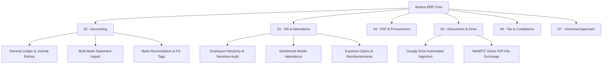

# Project Overview

**Status:** Implemented & Verified in Production Operations  
**Client / Domain:** Truck It In (Pvt) Ltd  
**Distribution:** Aureus ERP (`aureuserp/aureuserp`)  
**Parent Note:** [[Aureus ERP - Project Context]]  

---

## 1. Mission & Purpose

**Aureus ERP** is a modular enterprise resource planning application built on Laravel 13, Livewire 3/4, and Filament 5. The primary deployment is tailored for **Truck It In (Pvt) Ltd**, managing freight operations, supply chain logistics, multi-tiered approvals, financial accounting, geofenced workforce management, and cloud document automation.

The platform is designed to consolidate multiple operational silos into a single, highly audited, company-isolated database architecture where:
1. **Ledger Integrity is Sacred:** Financial statements (Trial Balance, Balance Sheet, Profit & Loss, Direct Cash Flow) derive solely from balanced, posted journal entries — never from cached or pre-stored numbers on account rows.
2. **Universal Multi-Tier Approval Chain:** All approval-requiring processes across HR (claims, leaves, sensitive data updates), Operations, and Finance route through a unified, audit-logged [[Approval Workflow]] engine.
3. **Strict Company Boundary:** Multi-company scoping prevents data leakage across legal entities while providing role-based segregation of duties.
4. **Document Provenance:** Accounting source files, bank statements, and vendor bills maintain verifiable provenance through SHA-256 integrity checksums and Google Drive automated synchronization.

---

## 2. Core Functional Pillars

Aureus ERP is organized around six interconnected domains:



- **[[Accounting Overview]]:** Double-entry General Ledger (`accounts_account_moves`), period locks, configurable bank statement imports, FS Tag rule evaluation, multi-currency conversions, and live reporting.
- **[[HR Overview]]:** Employee master records, hierarchical line and department reporting lines, GPS geofenced mobile attendance verification, leave management, and audit-logged sensitive identity edits.
- **[[Procurement Overview]]:** Vendor bills, purchase orders, request for quotations, three-way matching, and automated bill creation upon approval.
- **[[Document Architecture]]:** Dual-tier storage (`accounting_documents` disk, switchable between local and S3), automated inbound PDF OCR/classification from Google Drive, and automated outbound invoice export.
- **[[Tax Overview]]:** Tax group mapping, withholding taxes, sales tax rates, and tax registration compliance.
- **[[System Architecture]]:** Modular plugin architecture where business capabilities reside in self-contained packages managed via Composer.

---

## 3. Key Business Rules at a Glance

- **Double-Entry Invariant:** For every posted move, $\sum \text{Debit} = \sum \text{Credit}$. Non-balancing moves cannot be posted.
- **No Direct Ledger Mutation:** Posted ledger records (`accounts_account_move_lines`) are immutable. Corrections must occur via reversal journals or credit notes.
- **Centralized Approvals:** No module creates private approval tables. All multi-tier approvals interface with `support_approval_requests` via `ApprovalEngine`.
- **Tenant Isolation:** Every operational record carries a `company_id`. Cross-company record access is strictly prohibited at both query and policy levels.

---

## 4. Source Navigation & Related Documents

- **Monorepo Root Context:** [[AI Context]]
- **Installed Stack & Packages:** [[Tech Stack]]
- **Operational Progress & Verification Matrix:** [[Current Status]]
- **Engineering Architecture:** [[System Architecture]]

```text
Source Locations:
app/Providers/Filament/AdminPanelProvider.php
plugins/webkul/accounts/src/Models/Move.php
plugins/webkul/support/src/Services/ApprovalEngine.php
plugins/webkul/employees/src/Services/HrHierarchyService.php
```
