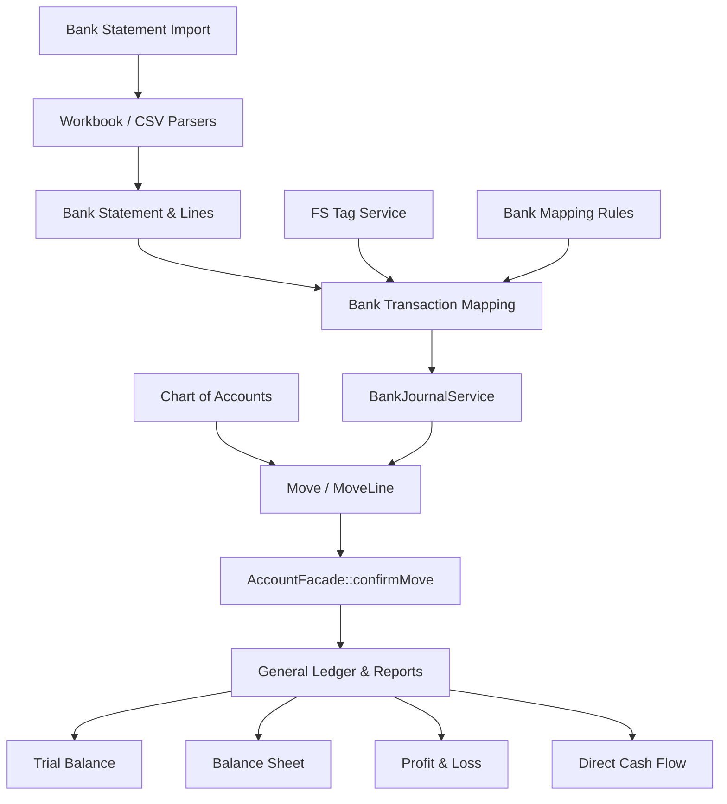

# Accounting Overview

**Status:** Implemented & Verified in Production Operations  
**Parent Note:** [[Project Overview]]  
**Sub-Notes:** [[Chart of Accounts]], [[Journal Entries]], [[Bank Statements]], [[Bank Import]], [[Reconciliation]], [[FS Tags]], [[Exchange Rates]], [[Partner Analytics]]  

---

## 1. Domain Purpose

The Accounting domain provides a complete, double-entry general ledger, compliant financial reporting suite, multi-bank statement import engine, automated transaction categorization, and financial period governance for Aureus ERP and Truck It In.

---

## 2. Component Relationship Diagram



---

## 3. Core Principles

1. **The Ledger is the Sole Source of Truth:**
   All financial reporting (Trial Balance, P&L, Balance Sheet, Cash Flow) is calculated on the fly by aggregating posted journal lines (`accounts_account_move_lines`). Balances are never cached or written onto accounts.
2. **Balanced Entries Only:**
   No entry can transition from `draft` to `posted` unless debits equal credits in company currency.
3. **Audit Trail & Immutability:**
   Once a move is `posted`, it cannot be modified or deleted directly. Adjustments require reversing journal entries or formal credit notes.
4. **Period Lock Safety:**
   `PeriodLockService` enforces hard closing dates, preventing unauthorized or backdated postings into locked accounting periods.

---

## 4. Source References

```text
plugins/webkul/accounts/src/AccountManager.php
plugins/webkul/accounts/src/Models/Move.php
plugins/webkul/accounting/src/Services/ReportCalculationEngine.php
plugins/webkul/accounting/src/Services/TrialBalanceService.php
```
