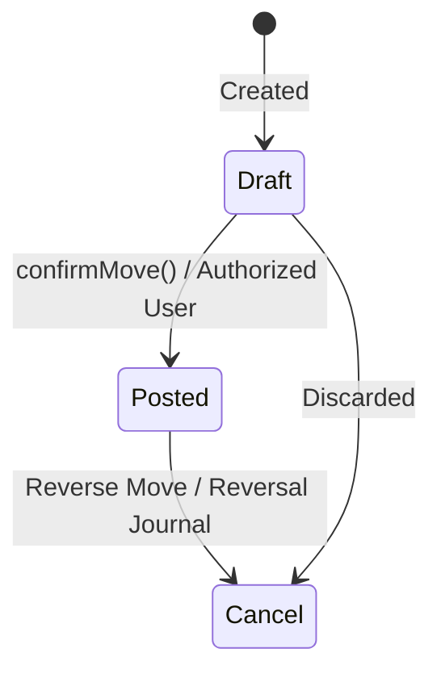

# Journal Entries & General Ledger Moves

**Status:** Implemented & Verified  
**Parent Note:** [[Accounting Overview]]  

---

## 1. Move Lifecycle & State Machine

All journal entries, vendor bills, customer invoices, credit notes, and refunds share the `Webkul\Account\Models\Move` model.



### Lifecycle States:
- **`draft`:** Editable. Debits and credits can be adjusted. Has no impact on financial reports.
- **`posted`:** Locked and immutable. Lines hit the General Ledger. Sequenced with official numbering (e.g. `BILL/2026/121` or `INV/2026/001`).
- **`cancel`:** Voided transaction.

---

## 2. Double-Entry Validation

Before any move can transition to `posted`, `Webkul\Account\AccountManager` executes strict debit/credit balance verification:
$$\sum \text{Debit} = \sum \text{Credit}$$

If $\Delta \neq 0$, the posting operation aborts with a validation exception.

---

## 3. Period Lock Protection

The `PeriodLockService` checks the `accounts_period_locks` table before confirming or modifying moves:
```php
if ($move->date <= $periodLock->lock_date) {
    throw new PeriodLockedException("Cannot modify transactions in a locked period.");
}
```
Period locks prevent accidental modification or backdated insertion into finalized quarters or financial years.

---

## 4. Reversal Workflow

Because posted moves cannot be deleted (`DeleteAction` calls `$action->halt()`), adjusting a posted entry is accomplished by:
1. Creating a reverse move (`reverse_move_id` link).
2. Swapping debits and credits from the original entry.
3. Posting the reversal move to zero out the financial effect.

---

## 5. Source References

```text
plugins/webkul/accounts/src/Models/Move.php
plugins/webkul/accounts/src/Models/MoveLine.php
plugins/webkul/accounts/src/AccountManager.php
plugins/webkul/accounts/src/Services/PeriodLockService.php
```
