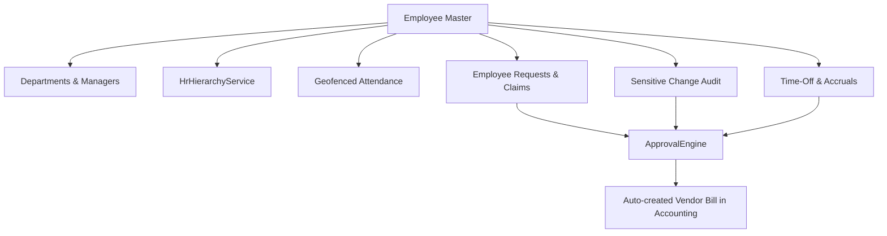

# HR Overview

**Status:** Implemented & Verified in Production Operations  
**Parent Note:** [[Project Overview]]  
**Sub-Notes:** [[Onboarding]], [[Attendance]], [[Leave]], [[Reviews]], [[Timesheets]], [[Expenses]]  

---

## 1. Domain Purpose

The Human Resources (HR) domain in Aureus ERP manages organizational structure, employee lifecycles, geofenced mobile attendance, leave entitlements, performance cycles, and expense claims.

---

## 2. Core Architecture & Services



### 1. `HrHierarchyService`
- Resolves reporting trees dynamically using employee `parent_id` (Line Manager) and department `manager_id` (Department Head).
- Enforces organizational visibility: managers can inspect subordinate records while general employees access only self-service data.

### 2. Universal Approval Integration
All HR requests (Leaves, Missing Attendance, Time Adjustments, Identity/Bank Changes, Expense Claims) route through `Webkul\Support\Services\ApprovalEngine`. No HR component uses isolated approval tables.

### 3. Financial Bridge
Approved expense claims and reimbursements automatically generate real double-entry Vendor Bills (`move_type = in_invoice`) in the accounting system via `EmployeeRequestService::createAccountingDraft()`.

---

## 3. Source References

```text
plugins/webkul/employees/src/EmployeePlugin.php
plugins/webkul/employees/src/Models/Employee.php
plugins/webkul/employees/src/Services/HrHierarchyService.php
plugins/webkul/employees/src/Services/EmployeeRequestService.php
```
