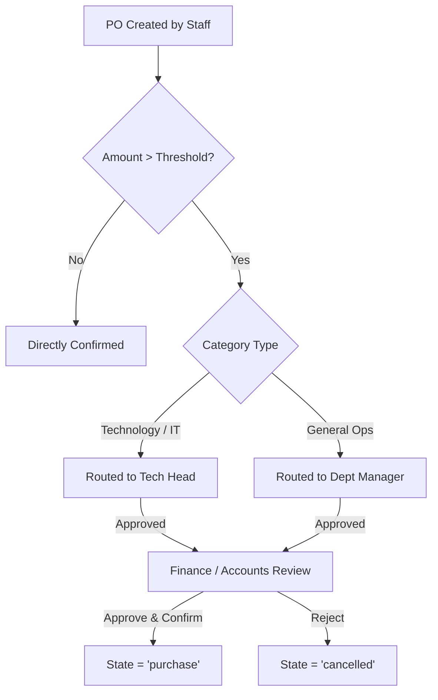

# Approvals

Status: Implemented / Verified
Related: [[Procurement Overview]], [[Purchase Orders]], [[Expenses]], [[Authorization & Company Scoping]]

Procurement and expenditure approvals in Aureus ERP enforce multi-tiered organizational control over commercial commitments. Approval logic covers Purchase Orders, Vendor Bills, and Expense Claims.

---

## 1. Approval Architecture & Policy Hierarchy

The approval engine operates through a dual mechanism:
1. **Configurable Threshold Rules** (`OrderSettings` & `purchases_order_settings`):
   - Purchases exceeding a company-configured financial threshold (e.g. PKR 100,000) automatically transition into `to_approve` status rather than directly to `purchase`.
2. **Departmental & Functional Head Routing**:
   - Technical requisitions (IT equipment, software licenses, AWS/cloud hosting) route to the **Tech Head** (Raza Afzal / designated technical authority).
   - Administrative, HR, and travel requests route through department leads before reaching Finance.



---

## 2. Purchase Order Approval Engine

In `plugins/webkul/purchases/src/Filament/Admin/Resources/OrderResource.php`:
- **Policy Enforcement**: `PurchaseOrderPolicy::approve` verifies whether the authenticated user possesses the `approve_purchase_order` permission or acts as the company's designated Approver.
- **Server-Side Validation**: Approval actions validate that:
  - The order is currently in `to_approve` status.
  - The approving user belongs to `user_allowed_companies` for the order's `company_id`.
  - All lines contain valid tax tags, delivery schedules, and positive unit costs.
- **Action Execution**:
  ```php
  Action::make('approve')
      ->label('Approve Order')
      ->color('success')
      ->visible(fn (Order $record): bool => 
          $record->state === 'to_approve' && auth()->user()->can('approve', $record)
      )
      ->action(fn (Order $record) => $record->actionApprove());
  ```

---

## 3. Expense Approvals & Downstream Ledger Impact

As established in the [[Expenses]] domain:
- When a technical expense claim is submitted (e.g. GitHub enterprise licenses, laptop repair), approval by **Raza Afzal** (Tech Head) transitions the expense claim to approved status.
- Once approved by the department head and validated by Accounts:
  - An automated vendor bill `AccountMove` (`BILL/2026/xxx`) is created.
  - Posting this bill creates the general ledger entry debiting `6111000 - IT & Software Expenses` and crediting `2111000 - Accounts Payable` (or employee payable).
  - This guarantees that no financial liability reaches the ledger without explicit technical and financial authorization.

---

## 4. Multi-Company & Self-Approval Guards

- **Strict Company Scope**: Approvers can only view and act on approval queues within their active company context.
- **Self-Approval Guard**: Originators of purchase orders or expense requests cannot self-approve if their claim exceeds tier thresholds.
- **Audit Logging**: Every approval transition records the approver's `user_id`, timestamp, and approval remarks for regulatory audit trails.
