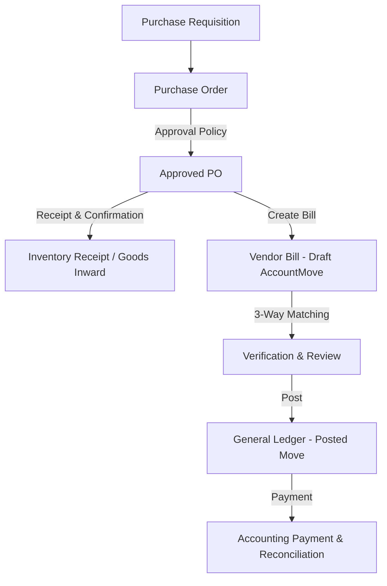

# Procurement Overview

Status: Implemented / Partially Verified
Related: [[System Architecture]], [[Purchase Orders]], [[Vendors]], [[Approvals]], [[Journal Entries]], [[Chart of Accounts]]

The Procure-to-Pay (P2P) pipeline in Aureus ERP coordinates product requisitioning, purchase order lifecycle management, vendor partner coordination, receipt verification, and automated downstream accounts payable (AP) bill generation.

---

## 1. Module Architecture & Topology

P2P functionality is distributed across three core plugins:
1. **`purchases`** (`plugins/webkul/purchases`):
   - Purchase requisitions (`Requisition`, `RequisitionLine`)
   - Purchase orders (`Order`, `OrderLine`, `OrderGroup`)
   - Vendor pricing sheets (`VendorPriceListController`, `ProductSupplier`)
   - Downstream bill triggers (`ComputePurchaseOrderFromMoveListener`)
2. **`partners`** (`plugins/webkul/partners`):
   - Vendor entity masters, tax IDs (`NTN`/`STRN`), banking details, and payment terms
3. **`accounts` / `invoices`** (`plugins/webkul/accounts`, `plugins/webkul/invoices`):
   - Vendor bill generation (`AccountMove`, `AccountMoveLine`), three-way matching, and general ledger posting

---

## 2. Key Entities & Database Schema

| Entity | Table | Core Responsibility |
|---|---|---|
| `Order` | `purchases_orders` | Header record for Purchase Orders and Quotations. Scoped by `company_id`. |
| `OrderLine` | `purchases_order_lines` | Line items detailing product, description, quantity, unit price, tax mappings, and account assignments. |
| `Requisition` | `purchases_requisitions` | Purchase agreements and tenders from internal departments. |
| `ProductSupplier` | `purchases_product_suppliers` | Vendor-specific product SKU aliases, lead times, and minimum order quantities. |
| `AccountMove` | `accounts_account_moves` | The unified ledger entry representing the generated Vendor Bill (`type = 'in_invoice'`). |

---

## 3. Procurement Workflow Stages

1. **Requisition & Quotation**:
   - Internal requisitions originate from departments or low-stock triggers in inventory.
   - Requests for Quotation (RFQs) are generated and dispatched to vendors via `VendorPurchaseOrderMail`.
2. **Purchase Order Confirmation**:
   - Purchase orders specify agreed currency, payment terms, delivery address, and lines.
   - Gated by company scoping (`user_allowed_companies`) and role-based policies (`PurchaseOrderPolicy`).
3. **Bill Generation**:
   - Upon PO confirmation, the system creates or links an `AccountMove` of type `in_invoice` (Vendor Bill).
   - Line items map directly from `OrderLine` to `AccountMoveLine` preserving accounts, taxes, and FS tags.
4. **General Ledger Settlement**:
   - Posting the bill debits the assigned expense or inventory asset account and credits Accounts Payable (`2111000 - Accounts Payable`).
   - Payment registration settles the payable against bank/cash accounts via [[Reconciliation]].

---

## 4. Multi-Company & Scoping Integrity

- Every purchase order, requisition, and bill must be strictly scoped to `company_id`.
- Users cannot confirm purchase orders for companies outside their active session or allowed scope (`user_allowed_companies`).
- Prior regression defect **DEF-006 / DEF-008** addressed leaks in purchase order lists where unauthorized company orders were visible; full company scoping is now enforced at both query builder and Filament resource layers.

---

## 5. Verification Status

| Workflow | Status | Verification Reference |
|---|---|---|
| Requisition creation | Implemented | `plugins/webkul/purchases/tests` |
| Purchase Order CRUD & Filament form | Implemented & Verified | `PurchaseOrderResourceTest`, `DEF-006` verification |
| PO to Vendor Bill conversion | Implemented | `ComputePurchaseOrderFromMoveListener` |
| Multi-company PO isolation | Verified | Feature tests in `purchases` suite |
| 3-Way Matching automated reconciliation | Partially Implemented | Requires receipt comparison |
