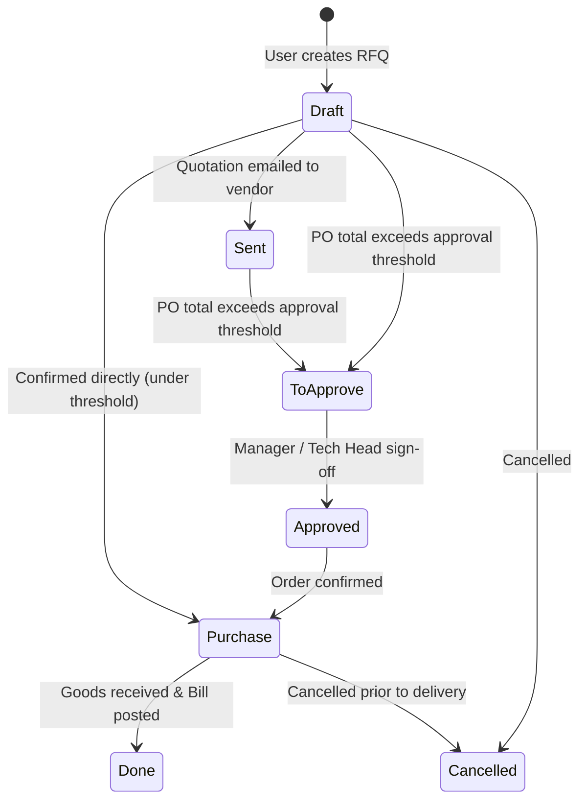

# Purchase Orders

Status: Implemented / Verified
Related: [[Procurement Overview]], [[Vendors]], [[Approvals]], [[Journal Entries]], [[Tax Requirements]]

Purchase Orders (`Order` in `plugins/webkul/purchases/src/Models/Order.php`) represent binding commitments made to external vendors for goods or services. They form the foundational source document for accounts payable and inventory intake.

---

## 1. Purchase Order Lifecycle & State Machine

Purchase orders progress through well-defined lifecycle states:

### State Definitions
- **`draft` (Draft / RFQ)**: Editable quotation stage. Line items and prices can be modified freely.
- **`sent` (Quotation Sent)**: Emailed to the vendor via `VendorPurchaseOrderMail`.
- **`to_approve` (Pending Approval)**: Triggered if `OrderSettings::get('purchase_order_approval_required')` is true or if total value exceeds the company's designated authorization limit.
- **`purchase` (Purchase Order Confirmed)**: Locked order. Creates downstream receipt expectations in `inventories` and exposes the **Create Bill** action.
- **`done` (Locked / Completed)**: Associated bills and stock moves have completed their lifecycle.
- **`cancel` (Cancelled)**: Revoked purchase order. Releases any associated reservations.

---

## 2. Order Header & Line Structure

### Header Attributes (`purchases_orders`)
- `name`: Human-readable sequence reference (e.g. `PO/2026/00042`).
- `partner_id`: Foreign key to `partners_partners` (the vendor).
- `company_id`: Strict tenant isolation.
- `currency_id`: Currency used for pricing.
- `currency_rate`: Rate to company base currency (PKR) at order time.
- `state`: Current lifecycle state (`draft`, `sent`, `to_approve`, `purchase`, `done`, `cancel`).
- `invoice_status`: Billing progress (`no` = nothing to bill, `to_invoice` = ready for billing, `invoiced` = fully billed).
- `receipt_status`: Inventory receipt progress (`no`, `pending`, `partial`, `full`).

### Line Attributes (`purchases_order_lines`)
- `order_id`: Parent order reference.
- `product_id`: Associated item from product catalog.
- `name`: Description of good/service.
- `product_qty`: Quantity ordered.
- `qty_received`: Quantity acknowledged by goods inward.
- `qty_invoiced`: Quantity billed in linked `AccountMoveLine`.
- `price_unit`: Unit cost in order currency.
- `price_subtotal`: Pre-tax line subtotal.
- `price_total`: Post-tax line total.
- `taxes`: Array/Pivot relation linking applicable tax definitions (`purchases_order_line_taxes`).

---

## 3. Bill Generation & Accounting Link

When a purchase order is in `purchase` state, authorized accounts payable users can trigger bill creation:
1. `ComputePurchaseOrderFromMoveListener` listens for bill lifecycle events.
2. An `AccountMove` with `type = 'in_invoice'` is instantiated.
3. For each `OrderLine`, an `AccountMoveLine` is created with:
   - Debit: Expense account (or Stock Interim Received account if tracked in inventory).
   - Debit: Tax input account (`2141000 - Sales Tax Recoverable`).
   - Credit: Accounts Payable (`2111000 - Accounts Payable`).
4. Line status updates `qty_invoiced` on `purchases_order_lines`.
5. When `qty_invoiced >= product_qty` across all lines, `invoice_status` transitions to `invoiced`.

---

## 4. Multi-Company & Security Guards

- **Scope Enforcement**: Every PO query is bound by `purchases_orders.company_id = active_company_id()`.
- **Policy Check**: `PurchaseOrderPolicy::viewAny`, `create`, `update`, `delete`, and `approve` are server-enforced using Spatie Shield permissions.
- **Defect Remediation**: Prior bug **DEF-006** addressed global PO visibility; filters and scoping now mandate that users only access orders matching their `user_allowed_companies`.

---

## 5. Verification Status

- **Status**: Implemented & Verified.
- **Tests**: `plugins/webkul/purchases/tests/Feature/OrderResourceTest.php`, `ComputePurchaseOrderTest.php`.
