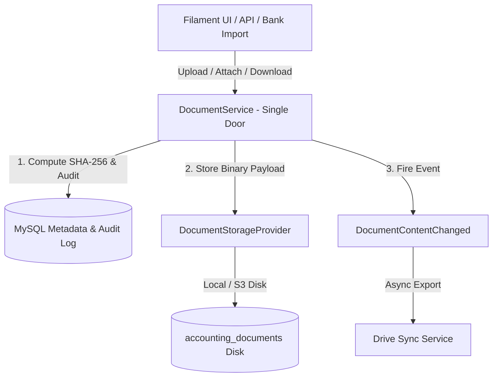

# Document Architecture

Status: Implemented / Verified
Related: [[System Architecture]], [[Drive Integration]], [[Upload Workflow]], [[Sync Workflow]], [[Retry & Failure Handling]], [[Journal Entries]], [[Bank Import]]

The Accounting Document Storage subsystem provides tamper-evident, versioned, company-isolated digital asset management for supporting financial records (invoices, bills, receipts, bank statements, contracts).

---

## 1. Design Principles & Single-Door Pattern

1. **MySQL / Aureus as Single Source of Truth**:
   - The ERP database holds the authoritative state and metadata of all financial documents.
   - External file storage (local disk or S3) serves purely as an immutable binary payload store.
2. **Single Authorized Entry Point (`DocumentService`)**:
   - **Crucial Invariant**: No controller, Filament page, or background job reads or writes the physical storage disk directly.
   - All mutations, attachments, downloads, and checksum validations must pass through `DocumentService`.
   - This architectural bottleneck guarantees that SHA-256 integrity, audit logging, and company isolation are impossible to bypass.
3. **Pluggable Storage Abstraction**:
   - Backed by `DocumentStorageProvider` contract.
   - Production/Local default: `LocalDocumentStorageProvider` using dedicated disk `accounting_documents`.
   - Cloud target: S3 driver switched via environment configuration (`DOC_STORAGE_DISK=s3`).

---

## 2. Domain Model Hierarchy

| Entity | Model Class | Table | Purpose |
|---|---|---|---|
| `Document` | `Webkul\Accounting\Models\Document` | `accounting_documents` | Primary document envelope: title, type, active status, company scope. |
| `DocumentVersion` | `Webkul\Accounting\Models\DocumentVersion` | `accounting_document_versions` | Versioned file contents: storage path, file size, MIME type, SHA-256 hash. |
| `DocumentAttachment` | `Webkul\Accounting\Models\DocumentAttachment` | `accounting_document_attachments` | Polymorphic linkage to financial records (`AccountMove`, `BankStatement`, etc.). |
| `DocumentAudit` | `Webkul\Accounting\Models\DocumentAudit` | `accounting_document_audits` | Immutable append-only log: user ID, IP address, timestamp, action. |
| `DocumentDriveSync` | `Webkul\Accounting\Models\DocumentDriveSync` | `accounting_document_drive_syncs` | Tracks external Google Drive export status, file IDs, and sync timestamps. |

---

## 3. Cryptographic Integrity & Tamper Detection

- **SHA-256 Fingerprint**: Calculated upon initial stream ingestion and recorded in `accounting_document_versions.checksum`.
- **Runtime Re-verification**: `DocumentService::download()` streams the file through a hash filter; if the computed SHA-256 does not match the stored checksum, the transfer aborts immediately with a security alert.
- **Scheduled Integrity Audit**: Artisan command `accounting:check-document-integrity` (`CheckDocumentIntegrityCommand`) scans all stored documents on disk, verifying hashes against the database and reporting missing or corrupted files.

---

## 4. Multi-Company Isolation

- All document queries are scoped by `company_id`.
- Polymorphic attachments cannot cross company boundaries; attaching a document from Company A to an invoice in Company B is blocked server-side by `DocumentService::attach()`.
- Verified in test suite: `DocumentCompanyIsolationTest.php`.
