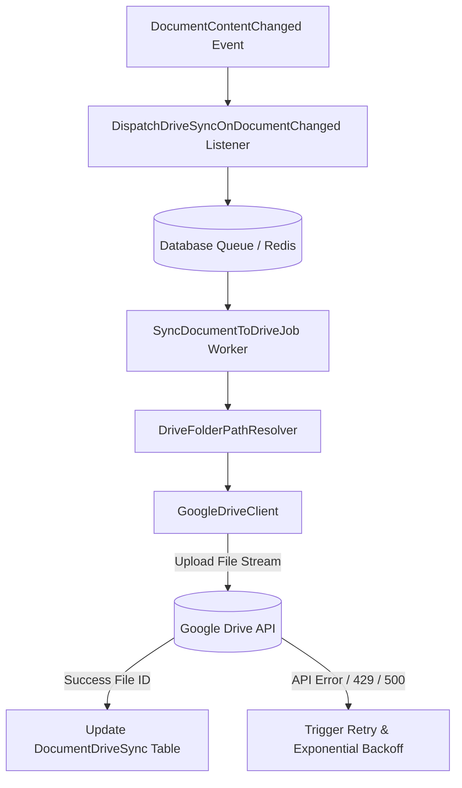

# Sync Workflow

Status: Implemented / Verified
Related: [[Document Architecture]], [[Drive Integration]], [[Upload Workflow]], [[Retry & Failure Handling]]

The Document Synchronization Workflow governs the automated, asynchronous propagation of documents between the ERP core and external cloud endpoints (specifically Google Drive).

---

## 1. Architectural Model

Synchronization is implemented as an event-driven, decoupled background process:



---

## 2. Synchronization Lifecycle & States

Every tracked document synchronization item is represented in `accounting_document_drive_syncs`:

| State | Description | Transition Trigger |
|---|---|---|
| `pending` | Queued for background transfer | Triggered on document creation or version update |
| `syncing` | Actively streaming to remote endpoint | Worker claims queue job |
| `synced` | Successfully pushed and verified | Google Drive returns valid `file_id` and metadata |
| `failed` | Error occurred during transfer | Network timeout, invalid credentials, or quota exceeded |
| `skipped` | Document type or company excluded | Sync policy filters out non-qualifying files |

---

## 3. Directory Path Resolution

`DriveFolderPathResolver` organizes documents within Google Drive into deterministic, human-readable directory trees:

```text
[Company Root Directory]
 ├── 2026/
 │    ├── Invoices/
 │    │    ├── INV-2026-0001/
 │    │    │    └── Invoice_INV-2026-0001_v1.pdf
 │    ├── Bills/
 │    │    ├── BILL-2026-0045/
 │    │    │    └── Vendor_Tax_Invoice.pdf
 │    └── Bank Statements/
 │         └── HBL_Statement_Jan_2026.xlsx
```

- If folders do not exist on Google Drive, `DriveFolderPathResolver` creates parent hierarchies recursively and caches folder IDs to prevent redundant API queries.

---

## 4. UI Synchronization Controls & Manual Trigger

In the Filament Document Hub (`DocumentResource`):
- Users can view real-time sync status (`Synced`, `Pending`, `Failed`).
- Direct action: **Sync to Drive Now** button triggers immediate inline queue dispatch for selected documents.
- Error diagnostics: Hover tooltips expose error details formatted by `DriveErrorFormatter` (e.g. "Rate limit exceeded, retrying in 45s").

---

## 5. Verification

- Verified via `DriveSyncExportTest.php` and `DriveSyncUiTest.php`.
- Verified folder tree generation and mock uploads using `FakeDriveClient`.
