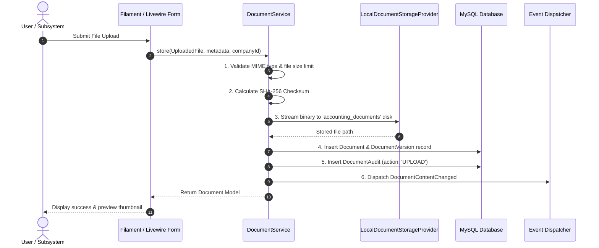

# Upload Workflow

Status: Implemented / Verified
Related: [[Document Architecture]], [[Drive Integration]], [[Sync Workflow]], [[Journal Entries]], [[Bank Import]]

The document upload workflow governs how files enter Aureus ERP, receive cryptographic verification, attach to business entities, and enter the versioning pipeline.

---

## 1. Upload Entry Points

Users and automated subsystems introduce documents via three primary surfaces:
1. **Central Document Hub**:
   - Navigation: **Accounting → Documents** (`DocumentResource`).
   - Direct file upload for contracts, tax certificates, audits, and unlinked receipts.
2. **Entity Supporting Documents Tab**:
   - Dedicated Livewire relation manager (`DocumentAttachmentsRelationManager`) wired directly onto:
     - Customer Invoices (`AccountMove` where `type = 'out_invoice'`)
     - Vendor Bills (`AccountMove` where `type = 'in_invoice'`)
     - Bank Statements (`BankStatement`)
     - Expense Claims
3. **Automated Subsystems**:
   - Bank import file attachment during spreadsheet processing.
   - External Drive polling via `DriveIngestionService`.

---

## 2. Ingestion & Validation Pipeline

Every upload is handled strictly by `DocumentService::store()`:

### Detailed Validation Rules
1. **File Type Filtering**: Strict whitelist of permissible accounting MIME types (`application/pdf`, `image/png`, `image/jpeg`, `application/vnd.openxmlformats-officedocument.spreadsheetml.sheet`, `text/csv`). Executable files (`.exe`, `.bat`, `.php`, `.sh`) are rejected.
2. **Size Limits**: Enforced per-tenant limit (default 25MB per file).
3. **Hash Calculation**: Stream-based SHA-256 computation avoids loading full file payloads into PHP memory buffers.

---

## 3. Versioning & Replacement Semantics

When an updated revision of an existing document is uploaded:
- A new `DocumentVersion` record is appended with incremented `version_number`.
- The previous version's binary payload remains untouched on disk (immutable history).
- Polymorphic attachments (`DocumentAttachment`) default to pointing at the latest version while retaining links to prior revisions.
- An audit entry `DocumentAuditAction::REPLACE_VERSION` is logged with the user ID and justification.

---

## 4. Verification

- Tested via `plugins/webkul/accounting/tests/Feature/Documents/DocumentServiceTest.php` and `DocumentSecurityTest.php`.
- Verified file storage integrity, checksum mismatch rejection, and multi-tenant scoping.
