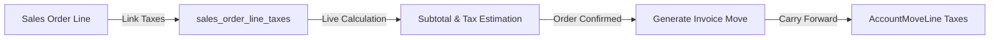

# Sales Order Tax

Status: Implemented / Verified
Related: [[Tax Overview]], [[Invoice Tax]], [[Tax Requirements]], [[Chart of Accounts]]

Sales Order Tax controls how quotation and sales order lines compute provisional taxes prior to invoice generation, ensuring pricing transparency for customers and commercial operations.

---

## 1. Role in Sales Pipeline

In `plugins/webkul/sales`:
- Sales orders (`SaleOrder` and `SaleOrderLine`) compute tax estimates to display complete quotes and contracted totals.
- Tax mappings are defined in pivot table `sales_order_line_taxes`.
- Taxes assigned at the quotation stage carry forward automatically into downstream invoices (`MoveType::OUT_INVOICE`) generated from confirmed sales orders.

---

## 2. Tax Computation & Recalculation

- When line quantity, unit price, or discount changes in the Filament Sales Order form, `TaxManager::computeAll()` recalculates:
  - `price_subtotal`: Untaxed line amount.
  - `price_tax`: Estimated tax amount.
  - `price_total`: Combined customer payable (`price_subtotal + price_tax`).
- Supports multi-tax stacking (e.g. Base GST + Provincial Service Cess).

---

## 3. Product Defaults & Fiscal Positions

1. **Product Master Defaults**:
   - Products specify default customer taxes via relation `ProductTaxes` (`accounts_product_taxes`).
   - Selecting a product auto-populates the assigned tax into the sales order line.
2. **Fiscal Position Overrides**:
   - If a customer is flagged as foreign (export) or special economic zone (SEZ), the customer's fiscal position replaces standard GST with 0% export rate.

---

## 4. Verification

- Implemented in `plugins/webkul/sales`.
- Verified through sales order lifecycle and invoice generation tests.
