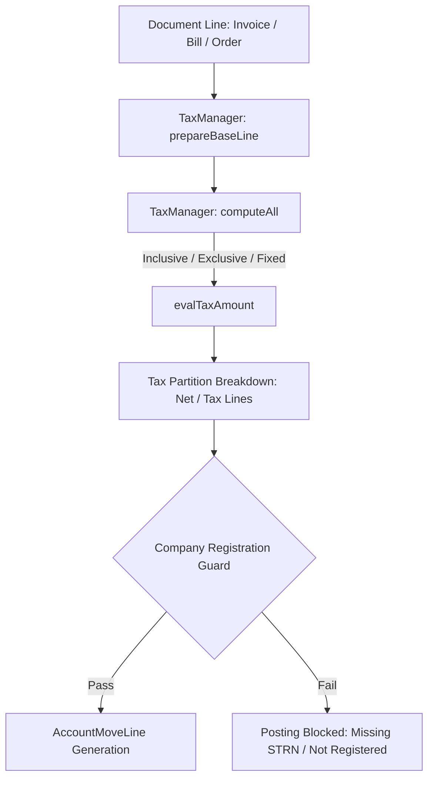

# Tax Overview

Status: Implemented / Verified
Related: [[System Architecture]], [[Invoice Tax]], [[Bill Tax]], [[Sales Order Tax]], [[Purchase Order Tax]], [[Tax Requirements]], [[Chart of Accounts]]

The taxation engine in Aureus ERP manages statutory tax compliance, calculation models (percentage, fixed, division), multi-tier tax partitions, and tax group classifications. It enforces statutory Pakistan compliance rules (FBR, SRB, PRA) while maintaining multi-company segregation.

---

## 1. Taxation Engine Core (`TaxManager`)

The tax computation architecture is centered on `Webkul\Account\TaxManager`:
- **`computeAll()`**: Evaluates base amounts, calculates line taxes, handles inclusive vs exclusive tax computation, and prepares journal debit/credit lines.
- **`prepareBaseLineForTaxesComputation()`**: Normalizes line records from Invoices, Bills, Sales Orders, or Purchase Orders into a unified computation array.
- **`roundBaseLinesTaxDetails()`**: Enforces currency rounding rules (`roundBaseLinesTaxDetails`) to prevent fractional penny discrepancies across multi-line documents.

---

## 2. Tax Models & Schema

| Model | Table | Purpose |
|---|---|---|
| `Tax` | `accounts_taxes` | Defines tax rates, computation type (`percent`, `fixed`, `division`), scope (`sale`, `purchase`), and GL accounts. |
| `TaxGroup` | `accounts_tax_groups` | Categorizes taxes for reporting and summary display (e.g. "GST 18%", "Withholding Tax 10%"). |
| `TaxPartition` | `accounts_tax_partitions` | Splits tax amounts between base tax expense/liability accounts and refund/offset accounts (`repartition_type`). |
| `FiscalPositionTax`| `accounts_fiscal_position_taxes` | Rules for dynamically mapping taxes based on customer/vendor jurisdiction or fiscal position. |

---

## 3. Statutory Compliance Guardrails

As validated in `TaxComplianceTest.php`:
1. **Sales Tax Registration Invariant**:
   - When posting a sales invoice (`type = 'out_invoice'`) that includes sales tax, the selling company **must** have `is_sales_tax_registered = true`.
   - If not registered, posting is rejected with exception: `sales-tax-not-registered`.
2. **STRN Invariant**:
   - If `is_sales_tax_registered = true`, the company **must** have a valid `strn` (Sales Tax Registration Number) populated.
   - If missing, posting is rejected with exception: `strn-required`.
3. **Purchases Exemption**:
   - Vendor bills (`type = 'in_invoice'`) with tax are **not** blocked by the purchasing company's registration status, since the sales tax on the bill belongs to the vendor's registration.

---

## 4. Verification

- **Status**: Implemented & Verified.
- **Pest Test Suite**: `plugins/webkul/accounts/tests/Feature/TaxComplianceTest.php` and `TaxPickerHardeningTest.php`.
