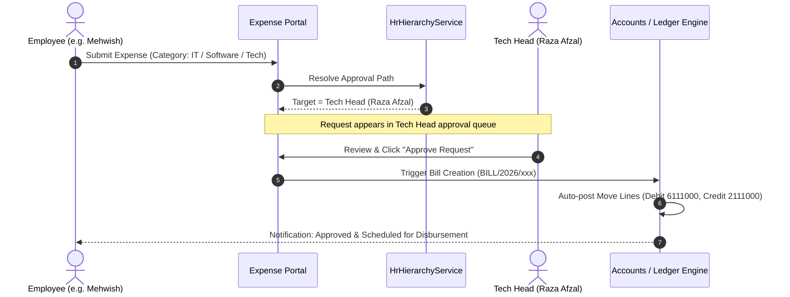

# Approval Workflow

Status: Implemented / Verified
Related: [[Approvals]], [[Expenses]], [[Leave]], [[Purchase Orders]], [[Authorization & Company Scoping]]

The Approval Workflow establishes the unified multi-tier sign-off protocol for commercial orders, expense claims, and HR requests across Aureus ERP.

---

## 1. Approval Routing Matrix

Aureus ERP enforces distinct approval paths based on operational domain:

| Domain | Request Type | Tier 1 Approver | Tier 2 Approver | Final Finance Gate |
|---|---|---|---|---|
| **Procurement** | Purchase Order (< 100k PKR) | Line Manager | — | Direct Confirmation |
| **Procurement** | Purchase Order (>= 100k PKR) | Department Lead | Financial Controller | CFO / Director |
| **Procurement** | IT / Software PO | **Tech Head** (Raza Afzal) | Finance Manager | Accounts Payable |
| **HR / Finance** | Tech Expense Claim | **Tech Head** (Raza Afzal) | Accounts Payable | Auto-posted Bill |
| **HR / Finance** | Ops / Travel Expense | Department Lead | Accounts Payable | Auto-posted Bill |
| **HR** | Annual / Sick Leave | Direct Supervisor | HR Manager | HR Attendance Engine |
| **HR** | Shift / Attendance Change | Direct Supervisor | HR Admin | HR Attendance Engine |

---

## 2. Technical Head Approval Path (Case Study)

As implemented and verified during recent engineering updates:

---

## 3. Server-Side Enforcement Rules

1. **Self-Approval Guard**:
   - Originators cannot approve their own submissions. If an approver submits an expense or PO, the ticket automatically escalates to their direct manager or the next higher authority.
2. **Company Boundary Check**:
   - Approvers can only act upon requests within companies where they hold active membership (`user_allowed_companies`).
3. **Audited State Transitions**:
   - Every approval or rejection action creates an immutable log record capturing approver ID, timestamp, and optional remarks.
