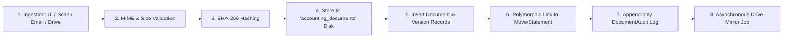

# Document Workflow

Status: Implemented / Verified
Related: [[Document Architecture]], [[Drive Integration]], [[Upload Workflow]], [[Sync Workflow]], [[Retry & Failure Handling]]

The Document Workflow describes the end-to-end processing pipeline for supporting financial evidence, from ingestion and cryptographic hashing to polymorphic linking and cloud mirroring.

---

## 1. Lifecycle Overview

---

## 2. Ingestion Channels

1. **User Direct Upload**:
   - Uploaded via Filament admin panels on Invoices, Bills, or the central Document Hub.
2. **Drive Watched Folder Ingestion**:
   - `DriveIngestionService` periodically polls configured company intake folders on Google Drive.
   - Files are fetched via `GoogleDriveClient`, passed through `PdfInvoiceTextExtractor`, and registered in the ERP.
3. **Automated Subsystem Attachments**:
   - Bank statement spreadsheets parsed during [[Bank Import]] are automatically archived as supporting documents attached to the resulting `BankStatement` record.

---

## 3. Cryptographic Verification & Audit Trail

- **SHA-256 Fingerprinting**:
  - Computed on the raw stream during storage.
  - Stored in `accounting_document_versions.checksum`.
- **Runtime Hash Re-Verification**:
  - Before streaming a file back to a user on download, `DocumentService::download()` recalculates the stream SHA-256.
  - If a hash mismatch occurs (indicating bit-rot or manual file manipulation on disk), the download is blocked and a security alert is recorded.
- **Audit Tracking (`accounting_document_audits`)**:
  - Actions logged: `UPLOAD`, `DOWNLOAD`, `ATTACH`, `DETACH`, `REPLACE_VERSION`, `ARCHIVE`, `RESTORE`.
  - Captures `user_id`, `ip_address`, `user_agent`, and timestamp.

---

## 4. Verification

- Verified via `plugins/webkul/accounting/tests/Feature/Documents/DocumentServiceTest.php` and `DocumentSecurityTest.php`.
