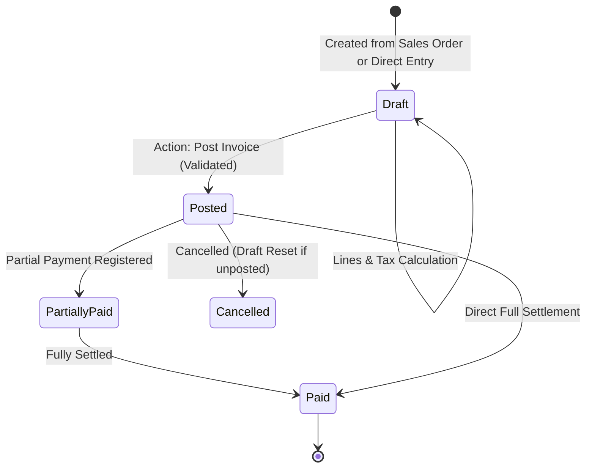

# Invoice Workflow

Status: Implemented / Verified
Related: [[Journal Entries]], [[Invoice Tax]], [[Reconciliation]], [[Document Architecture]], [[Partner Analytics]]

The customer invoice workflow guides financial transactions from creation and tax evaluation to ledger posting, payment capture, and bank reconciliation.

---

## 1. End-to-End Invoice Lifecycle

---

## 2. Step-by-Step Workflow Stages

### Stage 1: Invoice Creation
- **Origins**:
  - Automatically triggered upon sales order confirmation or delivery milestone.
  - Manually drafted in **Accounting → Customers → Invoices** (`InvoiceResource`).
- **Data Capture**: Customer partner, currency, payment terms, journal (`Customer Invoices`), and invoice date.
- **Line Items**: Product reference, account (e.g. `4111000 - Freight Revenue`), quantity, unit price, and sales tax.

### Stage 2: Tax & Balance Calculation
- Handled by `TaxManager::computeAll()`.
- Calculates untaxed subtotal, GST/SST tax breakdown, and total customer receivable.
- Real-time display updates in Filament form before saving.

### Stage 3: Posting & Ledger Invariants
- Triggered via `AccountHelper::post()` / Filament "Post" action.
- **Server-Side Validation**:
  - Verifies company's sales tax registration and STRN if taxes are present.
  - Generates immutable sequence number (e.g. `INV/2026/00142`).
  - Creates balanced `AccountMoveLine` entries (Debit Accounts Receivable, Credit Revenue, Credit Tax Payable).
  - Transitions `state` from `draft` to `posted`.
  - Dispatches `DocumentContentChanged` to queue PDF generation and Drive backup.

### Stage 4: Payment Registration & Reconciliation
- When customer pays via cheque, EFT, or bank wire:
  - User triggers **Register Payment** modal or imports bank statement.
  - Generates payment journal entry (`Payment` / `AccountMove`).
  - [[Reconciliation]] engine matches the payment move line with the invoice receivable move line, setting `payment_state = 'paid'`.

---

## 3. Multi-Company & Audit Guarantees

- Scoped strictly to active `company_id`.
- Post-action lock prevents modification of date, currency, partner, or amounts once posted.
- Correction requires issuing an official Credit Note (`MoveType::OUT_REFUND`).
