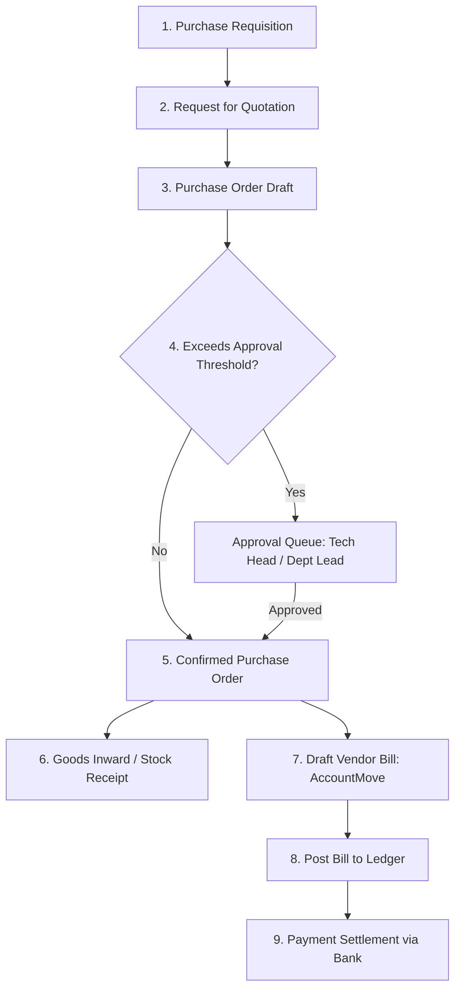

# Purchase Workflow

Status: Implemented / Verified
Related: [[Procurement Overview]], [[Purchase Orders]], [[Vendors]], [[Approvals]], [[Bill Tax]]

The purchase workflow encompasses the complete lifecycle from requisition and purchase order generation through receipt, vendor billing, and settlement.

---

## 1. Procurement Lifecycle Overview

---

## 2. Detailed Execution Steps

### Step 1: Requisition to PO
- User initiates requisition in `purchases` module.
- Generates RFQ dispatched to preferred vendor.
- Pricing, delivery dates, and tax codes are confirmed.

### Step 2: Approval Gate
- Orders exceeding the organizational approval ceiling are diverted to `to_approve`.
- Technical items (laptops, software, cloud services) route directly to **Tech Head** (Raza Afzal).
- General operational orders route through designated company department leads.

### Step 3: Confirmation & Stock Inward
- Order transitions to `state = 'purchase'`.
- If tracking inventory, automated incoming shipment documents are staged in `inventories`.

### Step 4: Vendor Bill Generation & Matching
- Accounts Payable generates the vendor bill (`MoveType::IN_INVOICE`).
- Line items, quantities, and prices map from `OrderLine` to `AccountMoveLine`.
- Applies input tax and withholding tax deductions according to vendor ATL status.

### Step 5: Ledger Posting & Settlement
- Bill is posted to GL:
  - Debit: Expense / Inventory Interim.
  - Debit: Input Tax Recoverable (`2141000`).
  - Credit: Withholding Tax Payable (`2143000`).
  - Credit: Accounts Payable (`2111000`).
- Settle via outbound payment or statement import matching.

---

## 3. Verification

- Tested through `ComputePurchaseOrderFromMoveListener` and purchase order feature suites.
