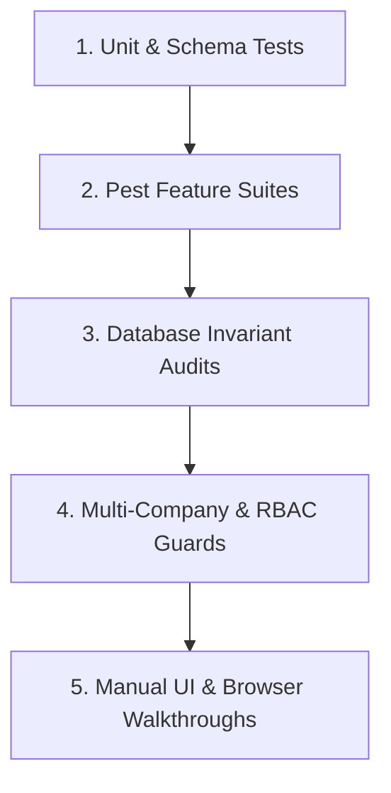

# Testing Overview

Status: Implemented / Verified
Related: [[Current Status]], [[Accounting Tests]], [[HR Tests]], [[Regression Tests]], [[Manual Testing]], [[Bugs]], [[Technical Debt]]

Testing in Aureus ERP ensures financial ledger integrity, strict multi-tenant isolation, role authorization, and workflow reliability. Testing blends automated Pest feature suites, direct database mathematical invariants, and manual browser walkthroughs.

---

## 1. Testing Stack & Environments

- **Framework**: Pest PHP v3 & PHPUnit 11 on PHP 8.3 / Laravel 13.
- **Environments**:
  - Dev Database: `aureuserp` (MySQL 8.4, single active production tenant: "Truck It In (Pvt) Ltd").
  - Test Database: `aureuserp_testing` (synced schema, isolated test fixtures).
- **Execution Command**:
  ```bash
  # Narrow suite run (preferred)
  php artisan test --compact --filter=TaxComplianceTest
  
  # Plugin-specific test run
  ./vendor/bin/pest plugins/webkul/accounting/tests
  ```

---

## 2. Multi-Tiered Verification Methodology



1. **Automated Feature Tests**:
   - Covers domain services, Livewire forms, and Filament actions.
   - Uses test helpers: `AccountHelper`, `DocumentTestHelper`, `TestBootstrapHelper`.
2. **Direct Ledger Mathematics Audits**:
   - Audits that `SUM(debit) == SUM(credit)` across all posted moves in the entire database.
   - Verifies the fundamental accounting equation:
     $$\text{Assets} = \text{Liabilities} + \text{Equity} + \text{Net Profit}$$
3. **Cross-Role Negative Path Testing**:
   - Uses real seeded users across 7 roles (`Admin`, `Accounting Manager`, `Accountant`, `HR Manager`, `Manager`, `Employee`, `No-Role`) with `Auth::loginUsingId()`.
   - Explicitly verifies that non-authorized actors are rejected with server exceptions.

---

## 3. Test Suite Health & Baseline Summary

| Plugin / Domain | Status | Pass / Fail Baseline | Notes |
|---|---|---|---|
| `accounting` | Passing | 17 / 17 (DEF-012 resolved) | Core accounting services, document storage, and drive sync mocks. |
| `accounts` | High Pass | 400+ Passing | Core moves, taxes, partner classifications. |
| `employees` / `time-off` | Passing | 135+ Passing | Attendance geofencing, leave workflows, hierarchy. |
| `partners` / `support` | Fully Green | 100% Passing | Master data, tenant scoping, currencies. |
| `sales` / `purchases` | Cleaned | 174 Passing (99 legacy skipped) | DEF-006 & DEF-007 company isolation fixes verified regression-free. |
| `inventories` / `manufacturing`| Legacy Debt | 732 / 33 Failed | Pre-existing upstream fixture gap; untouched during accounting/HR hardening. |

---

## 4. Defect Remediation Tracking

During Cycle 1 testing, 12 formal defects (**DEF-001** through **DEF-012**) were audited, remediated, and verified. Details documented in [[Regression Tests]].
