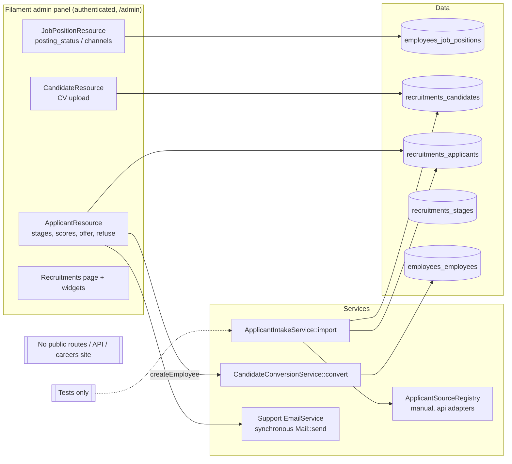
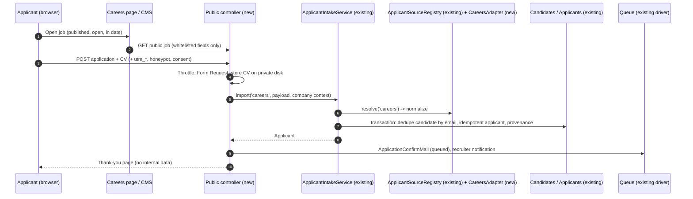
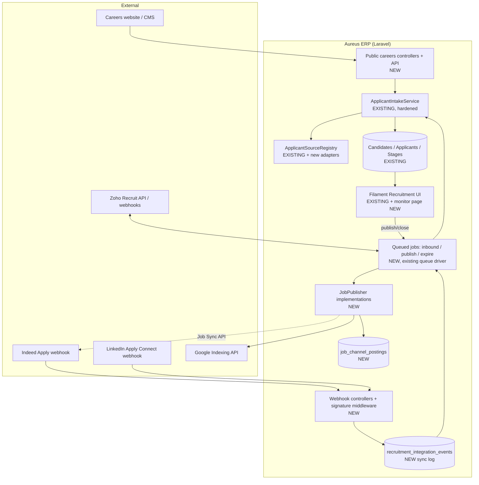

# Recruitment Plugin: Status Audit and Integration Roadmap

| | |
|---|---|
| **Audit date** | 2026-10-23 |
| **Scope** | `plugins/webkul/recruitments` and everything it depends on (employees, support/approvals, website, security, storage, mail) |
| **Stack (from `composer.lock`)** | Laravel 13.8.0 · Filament 5.6.3 · Livewire 4.3.0 · Pest 4.7.0 · MySQL |
| **Method** | Read-only. Source code was traced end to end, `php artisan route:list` was inspected, read-only counts were taken from the dev database, and the existing Recruitment tests were run. External platforms were checked against official provider documentation (links and dates in §6). |
| **Changes made** | None. This document is the only file created. |

Paths are relative to `plugins/webkul/recruitments/` unless they start with `plugins/`, `app/` or `config/`. Line numbers are approximate (±5) and refer to the code on the audit date.

**How to read the statuses**

| Status | Meaning |
|---|---|
| **Implemented and verified** | The code path works, and an existing automated test covers it |
| **Implemented but not fully verified** | The code path exists and looks correct, but tests cover it only partly or not at all |
| **Partially implemented** | Some of the required behaviour exists; important parts are missing |
| **Interface or scaffold only** | Contracts or classes exist, but nothing in production uses them |
| **Configured but not operational** | Settings or labels exist, but nothing acts on them |
| **Missing** | Searched for and not found |
| **Broken** | The code exists but produces wrong results |
| **Blocked by external access or credentials** | Needs a provider agreement, account or keys |

---

## 1. Executive Summary

**What is implemented.** Recruitment works as an **internal, recruiter-operated tool inside the Filament admin panel**:
- job positions, with a posting status
- candidates and applications
- a stage pipeline with hired, refused and archived handling
- scores, offer fields and refuse emails
- a dashboard and widgets
- a robust **candidate-to-employee conversion service**, which is company-safe, idempotent and tested

The application intake architecture (`ApplicantIntakeService`, `ApplicantSourceRegistry`, source adapters) exists. It handles idempotency, candidate de-duplication and provenance, and is tested.

**What is incomplete.**
- There are no job requisitions or approvals.
- There is no interview scheduling.
- There are no offer documents or offer approval.
- There is no CSV import.
- Several form fields are not company-scoped.
- CV storage is not safe.
- Some UI paths are untested or broken (details in §3–§4).

**Is it ready for a public careers website? No.**
- There are **no public routes, no API controllers and no careers pages**. `route:list` shows only authenticated `admin/*` Filament routes.
- The intake service has **no production caller**.
- CV uploads would land on the **web-served `public` disk**.

**Which integrations are operational? None.**
- **Scaffolding only:** the source-adapter contract and two adapters (`manual` and a payload-normalising `api`), plus seven unused `JsonResource` classes under `src/Http/Resources/V1`.
- **Labels only:** "LinkedIn" and "Indeed" appear only as options in the job form's `posting_channels` field. No code acts on them.

**Feasible, but needs provider access:**

| Platform | Situation |
|---|---|
| **Indeed** | Job Sync API plus Indeed Apply were opened to direct employers on 2026-07-31, but onboarding still needs a Developer Agreement and Indeed approval |
| **LinkedIn** | Its Job Posting API and Apply with LinkedIn are **not accepting new partners** |
| **Zoho Recruit** | Has a usable REST API, but it is a competing ATS, not a job board |
| **Google for Jobs** | Needs **no approval** and is the cheapest first channel |

**Largest risks** (details in §8):
1. CVs on the public disk.
2. The conversion permission is bypassed on four page actions.
3. Other companies' candidates, users and jobs are offered in form dropdowns.
4. Global pipeline stages can be edited by any company.
5. The intake service does no authorization check and trusts the `resume_path` it is given.

**What to build next:**
1. Fix the Stage 1 defects.
2. Then build an **Aureus-hosted careers portal**: a public job list and job page with schema.org `JobPosting` data, and a secure application form. The form feeds the existing `ApplicantIntakeService` through a new `careers` adapter.
3. Then add Google for Jobs (no approval needed).
4. Then Indeed, only after the business applies for partner access.

**Decisions from the 2026-10-23 discussion** (posting accounts, free vs paid, how CVs reach Aureus, WordPress, CV screening) are recorded in **§13 and §14**. Those sections take precedence over the generic recommendations above.

### Completion assessment (method)

The percentages below are **not file counts**. Each capability area gets a weight. Its status converts to a score:

| Status | Score |
|---|---|
| Implemented and verified | 1.0 |
| Implemented but not fully verified | 0.75 |
| Partially implemented | 0.4 |
| Interface or scaffold only | 0.15 |
| Missing or broken | 0 |

| A. Internal recruitment lifecycle | Weight | Status (from §3) | Score |
|---|---|---|---|
| Vacancies / job positions | 15 | Implemented but not fully verified | 11.25 |
| Requisitions and approval | 10 | Missing | 0 |
| Candidates and applications | 15 | Implemented but not fully verified | 11.25 |
| Pipeline and status transitions | 15 | Implemented but not fully verified | 11.25 |
| Interviews and assessments | 10 | Partially implemented | 4 |
| Offers | 5 | Partially implemented | 2 |
| CV and document handling | 10 | Partially implemented | 4 |
| Candidate → Employee conversion | 10 | Implemented and verified | 10 |
| Notifications | 5 | Implemented but not fully verified | 3.75 |
| Dashboards and reports | 5 | Implemented but not fully verified | 3.75 |
| **Total** | **100** | | **≈ 61 %** |

| B. External / public integration readiness | Weight | Status | Score |
|---|---|---|---|
| Public careers pages and public job API | 30 | Missing | 0 |
| Public application submission (endpoint + CV) | 20 | Scaffold only (service exists, no endpoint) | 3 |
| Source attribution | 10 | Partially implemented (UTM + provenance) | 4 |
| Job-board publishing | 20 | Labels only | 0 |
| External application ingestion / provider adapters | 15 | Scaffold only | 2.25 |
| Sync logs, retries, monitoring | 5 | Missing | 0 |
| **Total** | **100** | | **≈ 9 %** |

---

## 2. Architecture Today (verified)

`ApplicantIntakeService` is reachable **only from tests**, specifically `plugins/webkul/employees/tests/Feature/HrPlatformTest.php:403`.

---

## 3. Existing Implementation: Verified Features

| # | Feature | Status |
|---|---|---|
| 3.1 | Module structure and registration | Implemented but not fully verified |
| 3.2 | Job requisitions and approval workflows | **Missing** |
| 3.3 | Job creation and vacancy management | Implemented but not fully verified |
| 3.4 | Candidate records and applications | Implemented but not fully verified |
| 3.5 | Applicant intake service | Implemented but not fully verified (no production caller) |
| 3.6 | Applicant source registry and adapters | **Interface or scaffold only** |
| 3.7 | Manual candidate entry and imports | Partially implemented |
| 3.8 | Stages and status transitions | Implemented but not fully verified (one **broken** count) |
| 3.9 | Interviews and assessments | Partially implemented |
| 3.10 | Offer management | Partially implemented |
| 3.11 | CV and document handling | Partially implemented (security defect) |
| 3.12 | Candidate → Employee conversion | **Implemented and verified** |
| 3.13 | Permissions and company isolation | Partially implemented |
| 3.14 | Notifications and background processing | Implemented but not fully verified |
| 3.15 | Dashboards and reports | Implemented but not fully verified |
| 3.16 | API endpoints and integration contracts | **Interface or scaffold only** |
| 3.17 | Website-facing functionality | **Missing** |
| 3.18 | External job-board / ATS integrations | **Missing** (labels only) |

### 3.1 Module structure and registration: *Implemented but not fully verified*
- **Registration:** `src/RecruitmentServiceProvider.php:12-62`.
  - Registers 15 migrations (all recorded as run in the dev DB).
  - Depends on `employees`, provides install and seed commands, and binds `ApplicantSourceRegistry` as a singleton (`:57`).
  - Uninstall is an empty closure.
- **Panel:** `src/RecruitmentPlugin.php:84-110` registers on the `admin` panel only. It discovers Pages, Clusters (Applications, Configurations) and Widgets.
- **Limitations:**
  - `database/seeders/StageSeeder.php:15` runs `DB::table('recruitments_stages')->delete()`, which is **destructive** on re-seed.
  - The named Screening → Hired pipeline (`RecruitmentWorkflowSeeder`) is **not** called by `DatabaseSeeder`. The dev DB has the 6 demo stages instead.
  - Posting columns live on the employees table `employees_job_positions` but are added by this plugin (`database/migrations/2026_08_25_000013_extend_recruitment_pipeline.php:36-40`). That is a cross-plugin coupling.

### 3.2 Job requisitions and approval workflows: **Missing**
- Searched for `requisition|hiring_requirement|job_request` and for every `ApprovalEngine` caller. Recruitment has none.
- The "hiring requirement" in the tests is just `no_of_recruitment` on the job. Nothing approves a vacancy before it is published.
- **Reusable:** `plugins/webkul/support/src/Services/ApprovalEngine.php` and `ApprovalWorkflow`/`ApprovalStep`. These are already used by employee requests, time-off and accounting.

### 3.3 Job creation and vacancy management: *Implemented but not fully verified*
- **Model:** `src/Models/JobPosition.php` extends `Webkul\Employee\Models\EmployeeJobPosition` (table `employees_job_positions`).
  - Adds `recruiter_id`, `manager_id`, `industry_id`, `address_id`, `date_from`, `date_to` and `no_of_hired_employee`.
  - Has `interviewers()` and `applications()` relations, and computed counts (`:202-292`).
- **Resource:** `src/Filament/Clusters/Configurations/Resources/JobPositionResource.php`.
  - Department and recruiter/interviewer selects are company-scoped (`:105`, `:159-186`).
  - Fields: `posting_status` (draft/published/paused/closed, `:267-277`), `published_at` (`:278`), `posting_channels` (`:282-293`).
  - `getEloquentQuery()` is scoped to the default company (`:632-636`).
- **Tests:**
  - `tests/Feature/RecruitmentWorkflowTest.php`: "tracks Job Posting as a distinct lifecycle…"
  - `tests/Feature/TestRecruitmentScenarioTest.php`: "1-3. PASS…"
  - Both test the model only.
  - `plugins/webkul/employees/tests/Feature/HrPlatformTest.php:454` tests company scoping.
- **Limitations:**
  - "Published" has no consumer.
  - `published_at` is not set automatically.
  - There is no `date_to ≥ date_from` rule.
  - There is no public slug and no separation between public and internal descriptions.
  - 10 of the 17 dev job positions have `company_id = NULL` and are invisible in the resource.
  - All 17 are `draft`.

### 3.4 Candidate records and applications: *Implemented but not fully verified*
- **Candidate** (`src/Models/Candidate.php`) is the person.
  - Soft-deleted and has chatter.
  - The `creating` hook defaults `company_id` (`:135-141`). The `saved` hook syncs a `Partner` (`:143-185`).
- **Applicant** (`src/Models/Applicant.php`) is the job-specific application.
  - Has a candidate, job, stage, interviewers, UTM source/medium, scores and offer fields.
  - The `creating` and `updating` hooks maintain `date_opened`, `last_stage_id` and similar fields (`:259-317`).
- **Constraint:** a unique index on `(company_id, external_application_id)`. There is **no** uniqueness on candidate email per company.
- **Limitations:**
  - The *Create application* modal (`.../ApplicantResource/Pages/ListApplicants.php`, the `using()` closure) reuses an existing application for the same candidate **regardless of job**. It also silently re-opens refused or archived applications, so a candidate effectively gets one application per company, not one per job.
  - `src/Http/Resources/V1/CandidateResource.php` references a non-existent `applications` relation.
- **Tests:** both plugin test files, and `HrPlatformTest.php:348`.

### 3.5 Applicant intake service: *Implemented but not fully verified (no production caller)*
- `src/Services/ApplicantIntakeService.php::import(string $source, array $payload, User $actor)` works as follows:
  1. Resolves the adapter and normalises the payload (`:22`).
  2. Validates it (`:23-36`): `external_application_id`, `candidate_name`, `candidate_email`, `job_id` and `source_details` are required, and `source_id`/`medium_id` must exist.
  3. Resolves the company (`:38-44`): the payload company or the actor's default. The actor must have access to it, otherwise a `RuntimeException` is thrown.
  4. Requires that the job belongs to that company (`:46-49`) and picks a global or company stage (`:50-61`).
  5. Inside a transaction (`:63-113`), it is idempotent on `(company_id, external_application_id)`, de-duplicates the candidate by email per company, and stores provenance in `applicant_properties.source_provenance`.
- **Test:** `HrPlatformTest.php:403` "normalizes idempotent manual and API applicant intake without crossing companies".
- **Limitations:**
  - It **requires a `User` actor**. A public submission has none, so it needs a system/integration actor or an explicit company context.
  - There is no `can()` authorization check.
  - It does not check that the job is published or open.
  - A re-import overwrites `stage_id`, `job_id` and `creator_id`, which can move a candidate back to an earlier stage.
  - `resume_path` is accepted as a plain string, with no file validation.
  - A validation failure throws an exception; there is no "needs review" queue.
  - UTM sources and mediums are global, not per company.

### 3.6 Applicant source registry and adapters: **Interface or scaffold only**
- Contract: `src/Contracts/ApplicantSourceAdapter.php` defines `key()` and `normalize(array): array`.
- Registry: `src/Services/ApplicantSourceRegistry.php`. Its constructor hard-codes two adapters (`:15-19`). It has `register()`, `resolve()` (throws for an unknown key) and `keys()`.
- Adapters:
  - `src/Services/SourceAdapters/ManualApplicantSourceAdapter.php` (`manual`)
  - `GenericApiApplicantSourceAdapter.php` (`api`). It only maps aliases such as `id`→`external_application_id` and `email`.
- There are **no HTTP calls, credentials, polling or webhooks**. Nothing calls `register()` with further adapters.

### 3.7 Manual candidate entry and imports: *Partially implemented*
- **Manual entry:**
  - `CandidateResource::form` (`.../CandidateResource.php:92-190`).
  - Applications are created from the `ListApplicants` header modal. There is no `/create` route.
- **Imports:** there is **no CSV or Excel import** (searched for `ImportAction|Importer|csv`).
- **Limitations:**
  - Candidate email is neither required nor unique.
  - The applicant form's `candidate.email_from/phone/linkedin_profile` fields (`ApplicantResource.php:~243-256`) are outside a relationship group, so they are likely not saved. *Not runtime-verified.*

### 3.8 Stages and status transitions: *Implemented but not fully verified*, one part **Broken**
- **Stage model:** `src/Models/Stage.php`. `company_id` NULL means a global stage. It also has `pipeline_code`, `is_default` and `hired_stage`.
- **Status:** `Applicant::getApplicationStatusAttribute()` (`Applicant.php:241-252`) derives the status in this order: refused → archived → hired → ongoing.
- **Transitions:**
  - `HasApplicationStatus::updateStatus()` (`src/Traits/HasApplicationStatus.php:49-90`).
  - `setAsHired` / `setAsRefused` / `reopen` (`Applicant.php:214-234`).
  - The stage stepper (`ApplicantResource.php:106-143`).
  - Refuse/restore (`EditApplicant.php:147-208`).
- **Tests:** `RecruitmentWorkflowTest` (pipeline seeder, global stages) and the `TestRecruitmentScenarioTest` "4-13", "7." and "14." tests, all at model level.
- **Limitations and defects:**
  - **Broken:** `JobByPositionResource.php:52, 106-111` counts "new applications" as `stage_id = 1`. The dev stage ids start at 14, so the count is always 0 and the link points nowhere.
  - ONGOING re-assignment picks `Stage::where('is_default',1)->first()` without company scoping (`HasApplicationStatus.php`).
  - The applicant table hides `state = blocked` rows from every tab (`ApplicantResource.php:742-748`).
  - Global stages can be edited by any company (see §8).

### 3.9 Interviews and assessments: *Partially implemented*
- **What exists:**
  - Interviewers per application (`recruitments_applicant_interviewers`) and default interviewers per job.
  - Screening, interview and assessment scores (0–100).
  - A 0–3 priority evaluation (`ApplicantResource.php:154-201, ~437`).
- **Missing:** interview scheduling, calendar or meeting records, interview feedback forms and scorecards. Only generic chatter activities exist.
- **Likely defect:** the interviewer select's save path depends on a non-fillable attribute plus `EditApplicant::afterSave` (`Applicant.php:298-316`, `EditApplicant.php:226-230`). Interviewer changes may not save. *Not runtime-verified.*

### 3.10 Offer management: *Partially implemented*
- **Fields:** `salary_expected(_extra)`, `salary_proposed(_extra)`, `offer_status` (draft/sent/accepted/declined/withdrawn) and `offer_date`.
- **Missing:** offer letters, offer approval and e-signature. `offer_status` does not drive hiring.
- The two "extra" salary labels appear swapped in the form.

### 3.11 CV and document handling: *Partially implemented* (security defect)
- `CandidateResource.php:124-129`: `FileUpload::make('resume_path')` accepts PDF, DOC and DOCX, uses directory `recruitment/cv` and `->visibility('private')`, but sets **no `->disk()` and no `maxSize`**.
- The effective disk is `FILESYSTEM_DISK=public` (`.env:50`, `config/filament.php:44`). That disk is web-served through the `public/storage` symlink. See §8.
- There is no download or preview action, and no virus scanning.
- The dev DB has 0 stored CVs.

### 3.12 Candidate → Employee conversion: **Implemented and verified**
- `src/Services/CandidateConversionService.php::convert(Applicant)`:
  - Runs in a transaction with row locks.
  - Returns the existing employee if it is in the same company, and throws if the employee is in another company.
  - Refuses refused applications.
  - Requires the company of the candidate, application, department and job to match.
  - Creates the `Employee`, links `candidate.employee_id` and marks the application hired.
- **Tests:**
  - `RecruitmentWorkflowTest` (5 tests: duplicate, other company, department mismatch, rejected, UI entry).
  - `TestRecruitmentScenarioTest` "4-13", "14.", "15.".
  - `HrPlatformTest.php:348`.
- **Limitations:**
  - The service itself has no authorization; see §8 for the permission bypass.
  - `redirect(... ['record' => null])` errors when the candidate has no partner.
  - No user account or onboarding is created.

### 3.13 Permissions and company isolation: *Partially implemented*
- **Policies** (`src/Policies/*`) check Shield permissions. Applicant and Candidate add ownership checks (`hasAccess(... 'recruiter' / 'manager')`). **No policy checks the company.**
- **Company isolation** is done only through `getEloquentQuery()` filtering on the default company:
  - `ApplicantResource.php:751-754`
  - `CandidateResource.php:333-336`
  - `JobPositionResource.php:632-636`
  - `JobByPositionResource.php:183-187`
  - `StageResource.php:389-395` (global + company)
- **HR roles** (`plugins/webkul/employees/src/Support/HrPermissions.php`):
  - `recruiter()` (`:316-330`) deliberately excludes `ConvertCandidates`.
  - `hiringManager()` (`:337-341`) includes it.
  - The auditor bundle is view-only.
- **Gaps:**
  - Unscoped form selects (§8).
  - Refuse reasons, degrees, applicant categories and UTM records are global.
  - No test covers the denials.

### 3.14 Notifications and background processing: *Implemented but not fully verified*
- **Mailables** (`src/Mail/`): `ApplicantRefuseMail`, `ApplicationConfirmMail`, `InterviewerAssignedMail`. Templates are in `resources/views/mails/`.
- **Sending:** `plugins/webkul/support/src/Services/EmailService.php:12-35` sends **synchronously** (`Mail::to()->send()`), logs to `EmailLog`, and uses the acting user's address as the sender.
- **Triggers:**
  - Refuse, with an optional notification (`EditApplicant.php:179-187`).
  - First stage assignment, which sends the confirmation (`Applicant.php:288-295`, `EditApplicant.php:222-252`).
  - Interviewer assignment.
- **Missing:** queued jobs, listeners and scheduled commands (none in `routes/console.php`), and mail tests.

### 3.15 Dashboards and reports: *Implemented but not fully verified*
- **Dashboard:** `src/Filament/Pages/Recruitments.php`, with filters, Shield-gated.
- **Widgets:**
  - `src/Filament/Widgets/JobPositionStatsWidget.php`: counts, trends and sparklines.
  - `ApplicantChartWidget.php`: status counts.
- **HR analytics funnel:** `plugins/webkul/employees/src/Services/HrAnalyticsService.php`, tested by `TestHrReportingScenarioTest.php:190`.
- **Limitations:**
  - `ApplicantChartWidget::canView()` (`:24-42`) checks a wrong permission name (`view_any_applicant`) plus `user id == 1`.
  - The archived count misses soft-deleted rows.
  - There is no source-effectiveness or time-to-hire report.

### 3.16 API endpoints and integration contracts: **Interface or scaffold only**
- `php artisan route:list` (818 routes): the only recruitment routes are authenticated Filament `admin/recruitments/*` and `admin/employees/configurations/job-positions*`.
- `src/Http/Resources/V1/` holds 7 `JsonResource`s (Applicant, Candidate, JobPosition, Stage, Degree, RefuseReason, ApplicantCategory) with **no controller, route or caller**.
- If exposed as they are, they would leak personal data: email, phone, LinkedIn, salaries, notes and provenance.

### 3.17 Website-facing functionality: **Missing**
- The `website` plugin (`plugins/webkul/website`) is **not installed** (`is_installed = 0`) and has no job or careers content (searched for `job|career|vacanc`).
- There is no public route, form or careers page. The `company_website` posting channel is a label only.

### 3.18 External job-board / ATS integrations: **Missing**
- Searched for `Http::|Guzzle|curl_|webhook|indeed|linkedin|zoho|greenhouse|lever|workable` across the plugin and `config/`.
- The only hits are the `posting_channels` option labels (`JobPositionResource.php:286-287`) and the candidate's `linkedin_profile` field.
- There are no credentials in `config/services.php` or `.env.example`.

**Dev data (read-only counts on the audit date):**

| Item | Count |
|---|---|
| Job positions | 17 (all `draft`; 10 with no company) |
| Applicants | 1 (hired, but not converted) |
| Candidates | 1 |
| Stages | 6 (all global) |
| UTM sources / mediums | 9 / 9 |
| Companies | 4 |

---

## 4. Implementation Gaps and Remaining Work

| Gap | Current state | Required behaviour | Existing code to reuse | Proposed change | Priority | Dependencies |
|---|---|---|---|---|---|---|
| Conversion permission | 4 page actions convert without `ConvertCandidates` | Only hiring managers convert | `HrPermissions::ConvertCandidates`, row-action check `ApplicantResource.php:695-697` | Add the check to Edit/View Applicant and Edit/View Candidate actions and inside `CandidateConversionService` | P0 | — |
| Private CV storage | Public disk, no size limit | Private disk, served only through an authorised download | `FileUpload`, `config/filesystems.php` `local` disk | `->disk('local')->maxSize(...)`, plus a signed or authorised download action | P0 | Decide retention |
| Company-scoped selects | Candidate, job, recruiter, interviewers and department selects list all companies | Only the current company | Scoping pattern already used in `JobPositionResource.php:105,159` | Add `modifyQueryUsing` to each select | P0 | — |
| Global stage protection | Any company can edit or delete global stages | Global stages read-only, except for admin | `StageResource::getEloquentQuery` | Policy: deny update/delete when `company_id` is null unless admin | P1 | — |
| Broken "new applications" count | Hard-coded `stage_id = 1` | Count applicants in the default or first stage | `Stage::is_default` | Resolve the default stage id | P1 | — |
| One application per job | The create modal reuses or re-opens any existing application | One application per (candidate, job); re-open only deliberately | Intake idempotency key | Change the `ListApplicants` `using()` lookup to include `job_id` | P1 | — |
| Requisitions and approval | Missing | Vacancy → approval → publish | `ApprovalEngine`, `ApprovalWorkflow` seeder pattern (`AttendanceWorkflowSeeder`) | Requisition approval step that gates `posting_status = published` | P1 | Approval matrix from HR |
| Interview scheduling | Missing | Schedule, invite, feedback | Chatter activities, `InterviewerAssignedMail` | `recruitments_interviews` table, feedback fields, queued invites | P2 | — |
| Offers | Fields only | Offer letter, approval, acceptance → hire | `ApprovalEngine`, PDF tooling if any | Offer document plus an approval step; `accepted` triggers the hire step | P2 | Offer template |
| Imports | Missing | CSV import of candidates and applications | `ApplicantIntakeService` + `manual` adapter | Filament importer that calls the intake service row by row | P2 | — |
| Public vacancy visibility | `posting_status` has no consumer | Published, open, in-date jobs are publicly listed | `JobPosition` posting fields | Public scope (`published` + date window + company) plus a public slug | P1 | Business: which companies and domains |
| Careers pages, API and application form | Missing | §5 | Intake service | New public controllers, views and API | P1 | Website decision |
| Public intake actor | Intake requires a `User` | Company context without a logged-in user | `import()` | Accept a `CompanyContext` or a dedicated per-company integration user | P1 | — |
| Intake hardening | No authorization check; re-import can move a candidate back a stage; `resume_path` trusted | Safe for untrusted sources | `import()` | Never move a candidate back a stage on re-import; accept uploaded files, not paths; check that the job is open | P1 | — |
| Confirmation email | Sent synchronously, only on first stage set in the admin edit form | Sent on submission, queued | `ApplicationConfirmMail`, `EmailService` | Queue the mailable; trigger from intake; use a company "from" address | P1 | Mail domain (SPF/DKIM) |
| Spam and abuse protection | N/A today (no public routes) | Rate limiting, honeypot or CAPTCHA, size limits | Laravel `RateLimiter` | `throttle` middleware plus a honeypot; CAPTCHA if abused | P1 | — |
| Consent and retention | Missing | Privacy notice, consent capture, retention and deletion | Candidate soft deletes | Consent fields, retention command (precedent: `hr:prune-attendance-evidence`) | P1 | Legal / HR policy |
| Source attribution | UTM source/medium + provenance JSON | Every public or external application tagged with channel and campaign | `UTMSource`, `source_provenance` | Map `?utm_*` / `?source=` and the adapter key automatically | P1 | — |
| Provider adapters | Only `manual` / `api` | Indeed, LinkedIn, Zoho, careers | `ApplicantSourceAdapter`, registry `register()` | One adapter per provider plus signed webhook controllers | P3 | Provider access (§6) |
| Outbound publishing | Labels only | Push, update and close jobs per channel | `posting_channels` | `JobPublisher` contract + per-channel publishers + sync log | P3 | Provider access |
| Sync logs, retries, monitoring | Missing | Visible success/failure, retry, alerts | Queue (`QUEUE_CONNECTION=database`), `EmailLog` precedent | `recruitment_integration_events` table, queued jobs with backoff, Filament monitor page | P2 | — |
| Analytics | Basic counts and funnel | Source effectiveness, time-to-hire, conversion per channel | `HrAnalyticsService`, widgets | Add metrics grouped by source/medium | P3 | Source attribution |
| Seeder safety | `StageSeeder` deletes all stages | Idempotent seeding | `RecruitmentWorkflowSeeder` (idempotent) | Make `StageSeeder` use firstOrCreate; call the workflow seeder | P1 | — |

---

## 5. Careers Website Integration

### 5.1 Options

| Approach | Fit with this repository | Notes |
|---|---|---|
| **A. Aureus-hosted careers portal** (public Blade/Livewire pages in this Laravel app, e.g. `careers.<domain>` or `/careers`) | **Best fit, recommended.** It reuses models, intake, mail and storage directly, needs no cross-site auth, and Google for Jobs markup is easy to add | The company website just links to it. It does not depend on the not-installed `website` plugin |
| B. Separate frontend (SPA, Next.js) consuming a Laravel API | Good, if a design team wants full control | Needs the public JSON API (5.3) plus CORS and an application POST endpoint |
| C. Company CMS (WordPress, Webflow, Framer) | Possible | The CMS fetches the public API, or embeds/links to the Aureus job page and form. The application must still be posted to Aureus server-side; never put API keys in the browser |
| D. `website` plugin | Not ready | Not installed and has no job features. It would need building out first |

**Business information still required:**
- which website technology the company uses, and its domain
- which companies and brands advertise jobs
- which languages
- whether salary is shown publicly
- consent and privacy text
- CV retention period
- who receives notifications
- whether CAPTCHA is acceptable

### 5.2 End-to-end workflow: what works today

| # | Step | Today | Work needed |
|---|---|---|---|
| 1 | Authorized recruiter creates a vacancy | ✅ `JobPositionResource` (company-scoped) | — |
| 2 | Vacancy passes approval | ❌ No approval | Requisition approval through `ApprovalEngine` |
| 3 | Vacancy published and discoverable | ⚠️ `posting_status`/`published_at` are stored but nothing reads them | Public scope + slug + auto `published_at` + closing on `date_to` |
| 4 | Website retrieves approved public job data | ❌ | Public list/detail pages and JSON API exposing only public fields |
| 5 | Applicant opens job details | ❌ | Job page with schema.org `JobPosting` JSON-LD |
| 6 | Applicant submits application and CV | ❌ | Form Request, private CV upload, honeypot/rate limit, consent |
| 7 | Aureus validates through its intake architecture | ⚠️ Intake exists but needs a user actor and trusts `resume_path` | `careers` adapter + company context + file handling |
| 8 | Candidate and job-specific application created or linked | ✅ in the intake service (email de-dup, idempotent) | Fix the one-application-per-company behaviour in the manual modal (§4) |
| 9 | Source recorded | ⚠️ provenance + UTM fields exist | Auto-map `utm_*` / referrer / adapter key |
| 10 | Recruiter sees it in Recruitment | ✅ `ApplicantResource` | Optional "new application" notification |
| 11 | Applicant gets confirmation | ⚠️ The mailable exists, but is only sent from the admin edit form and synchronously | Queue on submission |
| 12 | Application follows the pipeline | ✅ stages, status, conversion | — |

### 5.3 Recommended design (Approach A, with an API that also serves B and C)

**Public data (allowed to leave the system):**
- job title
- public description and requirements
- department name
- location and work type
- employment type
- posting and closing dates
- salary, only if the business allows it
- company name and logo
- the apply URL

**Confidential (never exposed):**
- recruiter and interviewers
- applicant counts
- salary budgets
- internal notes
- candidate data
- scores and offers
- provenance

Do **not** reuse `src/Http/Resources/V1/JobPositionResource.php` as-is. Create a dedicated `PublicJobResource` whitelist.

| Endpoint (proposed) | Auth | Purpose |
|---|---|---|
| `GET /careers` and `GET /careers/{company}/{job-slug}` | Public | HTML list and detail with `JobPosting` JSON-LD |
| `GET /api/public/v1/jobs?company=` | Public, cached, throttled | JSON list of published, open, in-date jobs |
| `GET /api/public/v1/jobs/{slug}` | Public | Public job detail |
| `POST /careers/{company}/{job-slug}/apply` (form) and `POST /api/public/v1/jobs/{slug}/applications` (API) | Public + CSRF (form) or signed key (server-to-server from a CMS) + `throttle` + honeypot | Submit an application |

**Submission flow:**
1. A Form Request validates name, email, phone, a CV of PDF/DOC/DOCX up to e.g. 5 MB, and consent.
2. The CV is stored on the **private** `local` disk under `recruitment/cv/{company}/{uuid}`.
3. The request calls `ApplicantIntakeService::import('careers', $payload, $context)`.
   - The `external_application_id` is a server-generated UUID per submission, plus a client idempotency token to stop double-submits.
4. The confirmation mail is queued.
5. The recruiter is notified (optional).

**Testing strategy (future):**
- Feature tests for each public endpoint:
  - only published, open, in-date, own-company jobs are listed
  - no confidential fields appear in the JSON
  - a valid submission creates exactly one candidate and one application
  - a double submit is idempotent
  - an oversized file or wrong MIME type is rejected
  - the CV is not reachable by URL
  - the rate limit returns 429
  - the honeypot rejects
- A test that the confirmation mail is queued.
- Cross-company tests: job A cannot receive an application for company B.

---

## 6. External Recruitment Platform Integration Matrix

**Categories:**
- **ATS:** a system of record for recruitment (Aureus itself, Zoho Recruit, Greenhouse, Lever).
- **Job board:** advertises vacancies (Indeed, LinkedIn, Rozee.pk, Bayt).
- **Careers website:** the company's own pages (§5).
- **Job-search engine:** discovers and indexes postings (Google for Jobs).

All external facts below were verified against official documentation on **2026-10-23**. "Conditional" means *requires provider access or business confirmation*. **Current Aureus readiness is the same for every platform:** no adapter, no outbound publisher, no webhook endpoint, no credentials. Only the generic adapter contract (§3.6) exists.

### 6.1 Indeed (job board, which also distributes to Glassdoor)

| Capability | Finding | Mechanism / auth | External approval | Feasibility |
|---|---|---|---|---|
| Outbound job publishing | Available | **Job Sync API** (GraphQL), OAuth 2.0 client credentials (1-hour tokens); or an **XML feed** (crawled URL or (S)FTP, refreshed every ~6 h) | Developer Agreement, partner request form, Indeed approval, questionnaire, certification (~6 weeks). The API was opened to **direct employers** on 2026-07-31. XML feeds are set up through an Indeed contact | Conditional |
| Inbound applications | Available | **Indeed Apply**: Indeed POSTs JSON to our `postUrl` (must return 2xx, no redirects), signed with `X-Indeed-Signature` (HMAC-SHA1 of the body with the API secret) | Indeed Apply token after partner approval; screener questions required for approval | Conditional |
| Candidate sync | "Candidate Sync APIs" exist | GraphQL / OAuth | Documented for ATS partners | Unconfirmed for direct employers |
| Application-status sync | Available | **Disposition Sync API** (`partnerDisposition.send`), part of the Job Sync certification roadmap | Partner | Conditional |
| Vacancy updates / closures | Available | Job Sync mutations; jobs **do not expire automatically**, so an explicit expire call is needed; XML `<expirationdate>` | Same as publishing | Conditional |
| Source attribution | Partial | Assigned source name; a `sponsored` flag on applications | Part of certification | Conditional |
| Glassdoor | Via Indeed | Jobs posted to Glassdoor are routed to Indeed | — | Same as Indeed |

Notes:
- **XML feeds from homegrown systems are explicitly exempt** from Indeed's single-source feed policy effective 2026-03-31.
- The Job Sync API overview still says "ATS partners" while the release notes say direct employers can use it. Confirm with Indeed.

Sources:
- https://docs.indeed.com/job-sync-api
- https://docs.indeed.com/job-sync-api/faq
- https://docs.indeed.com/job-sync-api/integrate-with-job-sync-api
- https://docs.indeed.com/release-notes/2026/2026-07-31
- https://docs.indeed.com/job-sync-xml/xml-feed
- https://docs.indeed.com/authentication
- https://docs.indeed.com/indeed-apply
- https://docs.indeed.com/indeed-apply/ats
- https://docs.indeed.com/indeed-apply/message-signature-generation
- https://docs.indeed.com/disposition-sync-api
- https://uk.indeed.com/help/employers/articles/single-source-feed-policy-effective-march-31-2026
- https://www.indeed.com/hire/resources/howtohub/how-employers-use-glassdoor-and-indeed

### 6.2 LinkedIn Talent Solutions (job board / professional network)

| Capability | Finding | Mechanism / auth | External approval | Feasibility |
|---|---|---|---|---|
| Outbound job publishing | Job Posting API exists, but **"not accepting new partnerships"** | Rest.li `simpleJobPostings`, OAuth 2.0 client credentials | Approved partners only; Basic Jobs XML feed only after a LinkedIn business review, aimed at third-party job sites | Conditional (unlikely via API) |
| Practical alternative | **Job Wrapping** copies jobs from our careers site | Crawls the careers pages (§5) | Requires purchased **Job Slots** | Conditional (commercial) |
| Inbound applications | **Apply Connect**: LinkedIn POSTs to our per-job `jobApplicationWebhookUrl`, signed `X-LI-Signature` (HMAC-SHA256); résumé available via `mediaUrl` for 30 days | OAuth + webhook | LinkedIn partner certification; applicant data needs a Recruiter licence. **Apply with LinkedIn is closed to new partners** | Conditional |
| Candidate sync | **Recruiter System Connect** (the documentation allows a "proprietary ATS" as customer) | OAuth 2-legged | Approved developers + Recruiter licence | Conditional |
| Application-status sync | Job Application Feedback API (Apply Connect) | OAuth | Partner | Conditional |
| Vacancy updates / closures | CLOSE / RENEW operations; default expiry 180 days | OAuth | Partner | Conditional |
| Source attribution | Docs instruct tagging the source "LinkedIn Easy Apply" | — | Partner | Conditional |

Sources:
- https://learn.microsoft.com/en-us/linkedin/talent/job-postings/api/overview
- https://learn.microsoft.com/en-us/linkedin/talent/job-postings/xml-feeds
- https://learn.microsoft.com/en-us/linkedin/talent/apply-connect/apply-connect-overview
- https://learn.microsoft.com/en-us/linkedin/talent/apply-connect/receive-applications
- https://learn.microsoft.com/en-us/linkedin/talent/apply-with-linkedin/apply-with-linkedin
- https://learn.microsoft.com/en-us/linkedin/talent/recruiter-system-connect
- https://learn.microsoft.com/en-us/linkedin/talent/job-postings/job-posting-release-notes
- https://www.linkedin.com/help/linkedin/answer/a545135

### 6.3 Zoho Recruit (an ATS, i.e. a second system of record)

| Capability | Finding | Mechanism / auth | External approval | Feasibility |
|---|---|---|---|---|
| Jobs | `Job_Openings` module | REST v2, OAuth 2.0 (authorization code; 1-hour access token + refresh token); scopes like `ZohoRecruit.modules.ALL` / `...candidates.CREATE` | A Zoho subscription; no partner programme | Confirmed (API exists) |
| Candidates | `Candidates` module; associate a candidate with a job (`PUT /recruit/v2/Candidates/actions/associate`) | REST v2 | Subscription | Confirmed |
| Application-status sync | `PUT /recruit/v2/{module}/status` | REST v2 | Subscription | Confirmed |
| Events back to Aureus | Workflow webhooks (POST/GET, max 10 fields, ports 80/443; per-day limits by edition); Notifications API | Webhook | Edition-dependent | Conditional |
| Publishing to boards | Zoho's own job-board connectors (in the Zoho UI) | — | Paid edition | Conditional |
| API limits | Rolling 24-hour credits, e.g. Free 5,000; Enterprise 15,000 + 1,000 per user (max 1,000,000). The "what's new" page gives different caps from the limits page | — | — | — |
| Data centres | US / EU / IN / AU / CN / JP; use the API domain returned during OAuth | — | — | — |

**Implication.** Zoho Recruit only makes sense if the business wants to **buy** job-board distribution rather than build it. In that case one system must own each entity, for example:
- Aureus owns requisitions and hires.
- Zoho owns sourcing and pipeline.

Status mapping, duplicate candidates and responsibility for consent all need explicit rules. Two-way sync between two ATSs is the highest-risk option.

Sources:
- https://www.zoho.com/recruit/developer-guide/apiv2/modules-api.html
- https://www.zoho.com/recruit/developer-guide/apiv2/oauth-overview.html
- https://www.zoho.com/recruit/developer-guide/apiv2/limits.html
- https://www.zoho.com/recruit/developer-guide/apiv2/multi-dc.html
- https://www.zoho.com/recruit/developer-guide/apiv2/associate-candidate.html
- https://www.zoho.com/recruit/developer-guide/apiv2/change-status.html
- https://help.zoho.com/portal/en/kb/recruit/automation/workflow/webhooks/articles/zoho-recruit-webhooks
- https://www.zoho.com/recruit/pricing.html

### 6.4 Google for Jobs (job-search engine: discovery only)

| Capability | Finding | Mechanism / auth | Approval | Feasibility |
|---|---|---|---|---|
| Outbound discovery | Yes | schema.org `JobPosting` JSON-LD on our own job pages. **Required:** `title`, `description`, `datePosted`, `hiringOrganization`, `jobLocation` (or `applicantLocationRequirements`). **Recommended:** `validThrough`, `employmentType`, `baseSalary`, `identifier`, `directApply` | None | **Confirmed** |
| Fast indexing | Yes | **Indexing API** `URL_UPDATED` / `URL_DELETED`; service account added as owner in Search Console; default 200 publish requests per day | None (free) | **Confirmed** |
| Closures | Yes | `validThrough`, 404/410 or `URL_DELETED`. Google warns that stale jobs can lead to a manual action | None | **Confirmed** |
| Applications / candidate / status sync | No: applicants apply on our site | — | — | Not applicable |
| Source attribution | Through our own UTM/analytics only | — | — | — |

Sources:
- https://developers.google.com/search/docs/appearance/structured-data/job-posting
- https://developers.google.com/search/apis/indexing-api/v3/quickstart
- https://developers.google.com/search/apis/indexing-api/v3/prereqs
- https://developers.google.com/search/apis/indexing-api/v3/quota-pricing
- https://developers.google.com/search/apis/indexing-api/v3/using-api

### 6.5 Other platforms

| Platform | Category | Finding | Feasibility |
|---|---|---|---|
| **Rozee.pk** | Job board (Pakistan) | No official public employer API or feed documentation found (the site blocked automated access) | Conditional: ask Rozee business sales for an XML feed or API |
| **Bayt.com** | Job board (MENA) | No official API documentation found | Unconfirmed |
| **Greenhouse** Job Board API / **Lever** Postings API | ATS | Public job JSON + key-protected application POST: a good **reference design** for our own public API (§5.3), not a target | Confirmed (for their customers only) |
| **ZipRecruiter** | Job board (mainly US/CA) | Partner XML feed import + HMAC-signed apply webhook, per partner docs (pages blocked; partnership needed) | Conditional; low relevance |
| **Broadbean** (multiposting) | Distribution service | APIs for posting and applicants "on request"; one contract can replace several board integrations | Conditional: commercial contract |

Sources:
- https://docs.greenhouse.io/job-board.html
- https://github.com/lever/postings-api
- https://www.ziprecruiter.com/partner/documentation/
- https://www.applytosupply.digitalmarketplace.service.gov.uk/g-cloud/services/908551021500336

**Not used anywhere in this plan:** scraping, unofficial browser automation and shared logins.

---

## 7. Target Integration Architecture

Extend the existing abstractions; do **not** build a parallel framework. The table separates existing (**E**) from new (**N**) components.

| Component | E/N | Role |
|---|---|---|
| `ApplicantIntakeService` | E (harden) | The single entry point for every inbound application. It gains a company context, file handling, a rule against moving a candidate back a stage, and an open-job check |
| `ApplicantSourceAdapter` + `ApplicantSourceRegistry` | E | Gains new adapters: `careers`, `indeed_apply`, `linkedin_apply_connect`, `zoho` |
| Provider field mapping | N (inside each adapter's `normalize()`) | Maps provider payloads to the intake schema |
| External ids | E: `external_application_id` with a unique `(company_id, external_application_id)` index | Idempotent ingestion. Add an `external_job_id` per channel in a new mapping table |
| `recruitment_job_channel_postings` | N | Per job and channel: external job id, status, last sync, last error |
| `JobPublisher` contract + `GoogleIndexingPublisher`, `IndeedJobSyncPublisher`, `XmlFeedPublisher` | N | Outbound publish, update and close |
| Webhook controllers + signature middleware (`VerifyIndeedSignature` HMAC-SHA1, `VerifyLinkedInSignature` HMAC-SHA256) | N | Verify, store the raw event, return 2xx quickly, queue processing |
| `recruitment_integration_events` (sync log) | N | Raw payload hash, status, attempts, error; visible on a Filament monitor page with a **Retry** button |
| Queue jobs (`ProcessInboundApplication`, `PublishJobToChannel`, `ExpireJobOnChannel`) | N, on the existing `database` queue | Backoff, rate-limit middleware, uniqueness per external id |
| Credentials | N | Per-company encrypted settings (Laravel `encrypted` cast) or `config/services.php` from `.env`; never in the code base |
| Monitoring | N | Failed-event count widget plus a notification to integration admins |

---

## 8. Security, Privacy and Reliability

| Severity | Finding | Evidence | Recommended fix |
|---|---|---|---|
| **High** (once used) | CVs stored on the web-served public disk; `visibility('private')` does not protect a local `public` disk; no size limit | `CandidateResource.php:124-129`; `.env` `FILESYSTEM_DISK=public`; `config/filament.php:44`; `public/storage` symlink | Private disk, size limit, authorised download, randomised names |
| **Medium** | Conversion permission bypass: header actions convert with no `ConvertCandidates` check; recruiters (who hold update rights) can create employees | `EditApplicant.php:105-125`; `ViewApplicant.php:87-106`; `EditCandidate.php:37-53`; `ViewCandidate.php:24-40`; only `ApplicantResource.php:695-697` checks | Check in all four actions **and** in `CandidateConversionService` |
| **Medium** | Cross-company data in form selects (candidate, job, recruiter, interviewers, department; candidate manager); picking a candidate auto-fills email/phone | `ApplicantResource.php:~230-330`; `ListApplicants.php`; `CandidateResource.php` | Scope every select to the current company |
| **Medium** | Global stages are editable and deletable by any company (Recruiter has `update_recruitment_stage`) | `StageResource.php:389-395`; `HrPermissions.php:324` | Policy: global stages admin-only |
| **Medium** (for public intake) | The intake service does no authorization check and trusts `resume_path` | `ApplicantIntakeService.php:22-61` | Authorise; accept only uploaded files |
| **Low** | Unescaped `{!! !!}` interpolation of candidate and job names in mail templates; the rendered HTML is also stored in chatter | `resources/views/mails/applicant-refuse.blade.php:3-5`, `application-confirm.blade.php:9-12`, `EditApplicant.php:243-251` | Escape user-controlled values |
| **Low** | Refuse-mail recipient is free text; the sender is the user's own address (deliverability and spoofing) | `EditApplicant.php:164-167`; `support/.../EmailService.php:15-25` | Lock the recipient to the candidate; company sender |
| **Low** | Policies never check the company; isolation relies on `getEloquentQuery` and the default company only | `src/Policies/*` | Add company checks to the view/update policies |
| **Info** | Salary, notes and scores are visible to anyone with applicant view permission (including auditors) | `ApplicantResource` infolist; `HrPermissions.php:380` | Field-level permission for offer and notes |
| **Info** | Not yet applicable, but required before going public: rate limiting, webhook signatures, malware scanning, consent, retention and deletion | No public routes today | Build into Stages 3–4 |

There is no candidate personal data, and no credentials, in this document.

---

## 9. Testing and Verification

| Item | Result |
|---|---|
| Command | `php artisan test plugins/webkul/recruitments/tests/Feature` (MySQL test DB `aureuserp_testing`, transactional, non-destructive) |
| Result | **14 passed, 105 assertions, 64 s, 0 failed** |
| `tests/Feature/RecruitmentWorkflowTest.php` (9 tests) | Pipeline seeder idempotency; full pipeline; posting lifecycle; duplicate conversion; `createEmployee()` idempotent; other-company employee; department mismatch; rejected application; global stages |
| `tests/Feature/TestRecruitmentScenarioTest.php` (5 tests) | Hiring requirement / job description / publish; pipeline to conversion; assessment skippable; rejected cannot convert (service + row action hidden); cross-company conversion blocked |
| Related tests elsewhere (not re-run) | `plugins/webkul/employees/tests/Feature/HrPlatformTest.php:348, :403, :454`; `TestHrReportingScenarioTest.php:190`; `Attendance/AttendanceEnhancementsTest.php:197` |
| Environment blocker | A comment in `TestRecruitmentScenarioTest` "14." notes that `Livewire::test(EditApplicant)` crashes PHP in this environment, so page header actions are untested |

**Not covered by any existing test:**
- Filament create/edit forms and CV upload
- mail sending
- the refuse/restore UI
- stage-stepper hire logic
- interviewer form persistence
- the header-action conversion permission
- widget data
- `JobByPosition` counts
- cross-company stage edits
- everything public or external (none exists)

**Recommended future tests:** the §5.3 suite, plus:
- webhook signature accept and reject
- idempotent replay of a provider event
- publisher retry and backoff
- a permission matrix (recruiter versus hiring manager versus auditor)
- CV not publicly reachable
- company-scoped selects

---

## 10. Implementation Roadmap

Estimates are preliminary and assume one developer who knows the code base.

| Code | Effort |
|---|---|
| S | ≤ 1 day |
| M | 2–4 days |
| L | 1–2 weeks |
| XL | > 2 weeks |

### Stage 1: Stabilise the existing plugin

| Task | Priority | Business value | Current state | Required work | Reuse | Files | Deps | Effort | Acceptance criteria | Risks |
|---|---|---|---|---|---|---|---|---|---|---|
| 1.1 Enforce conversion permission | P0 | Prevents unauthorised hires | Bypass in 4 actions | Add `ConvertCandidates` to actions + service | `HrPermissions` | Edit/View Applicant/Candidate pages, `CandidateConversionService` | — | S | A recruiter cannot convert from any page; a test proves it | Existing users lose access they shouldn't have |
| 1.2 Private CV storage | P0 | Protects personal data | Public disk | Private disk, size limit, authorised download | Filament `FileUpload` | `CandidateResource.php` | Retention decision | S–M | The CV URL is not reachable anonymously; download needs permission | Move any existing files |
| 1.3 Scope form selects to the company | P0 | No cross-company leak | Unscoped | `modifyQueryUsing` on each select | Pattern in `JobPositionResource` | `ApplicantResource.php`, `ListApplicants.php`, `CandidateResource.php` | — | S | Only own-company options; test | — |
| 1.4 Protect global stages | P1 | Shared pipeline integrity | Editable by all | Policy rule | `StagePolicy` | `src/Policies/StagePolicy.php` | — | S | Non-admins cannot edit or delete global stages | — |
| 1.5 Fix "new applications" count | P1 | Correct dashboard | Broken | Use the default stage | `Stage::is_default` | `JobByPositionResource.php` | — | S | Count matches the data | — |
| 1.6 Safe seeding | P1 | No data loss on re-seed | Destructive `StageSeeder` | firstOrCreate; call `RecruitmentWorkflowSeeder` | Workflow seeder | `database/seeders/*` | — | S | Re-seeding keeps applicants' stages | — |
| 1.7 Verify / fix interviewer and candidate-field persistence | P1 | Data entered is saved | Likely broken | Runtime test, then fix | — | `Applicant.php`, `EditApplicant.php`, `ApplicantResource.php` | — | M | Saved interviewers persist; test | `EditApplicant` Livewire crash in tests |

### Stage 2: Complete the internal lifecycle

| Task | Priority | Value | Current | Work | Reuse | Files | Deps | Effort | Acceptance | Risks |
|---|---|---|---|---|---|---|---|---|---|---|
| 2.1 Requisition approval before publishing | P1 | Controlled headcount | Missing | Approval workflow gating `published` | `ApprovalEngine`, workflow seeders | JobPosition resource + new seeder | HR approval matrix | M | A job can only become published after approval | Workflow design |
| 2.2 One application per job | P1 | Correct history | Reuses across jobs | Include `job_id` in the lookup; deliberate re-open | Intake idempotency | `ListApplicants.php` | — | S | A candidate can apply to two jobs | Data migration of existing rows |
| 2.3 Interview scheduling and feedback | P2 | Coordinated interviews | Scores only | Interviews table, invites (queued), feedback | `InterviewerAssignedMail`, chatter | New model/resource | — | L | Schedule → invite → feedback recorded | Calendar integration scope |
| 2.4 Offer letter and approval | P2 | Faster, auditable offers | Fields only | Offer document + approval; accepted → hire | `ApprovalEngine` | Applicant resource | Offer template | M–L | Offer approved and accepted before conversion | Legal template |
| 2.5 CSV import | P2 | Bulk intake | Missing | Filament importer → intake service | `ApplicantIntakeService` (`manual`) | New importer | — | M | Import is idempotent; errors reported per row | — |
| 2.6 Queued notifications | P1 | Reliability | Synchronous | `ShouldQueue` mailables; company sender | `EmailService` | `src/Mail/*` | Mail domain | S | Mail sent through the queue; failure does not block saves | Queue worker must run |

### Stage 3: Connect the public careers website (recommended first integration)

| Task | Priority | Value | Current | Work | Reuse | Files | Deps | Effort | Acceptance | Risks |
|---|---|---|---|---|---|---|---|---|---|---|
| 3.1 Public job visibility rules + slug | P1 | Safe publishing | Status unused | Scope: published + date window + company; slug; auto `published_at` | `JobPosition` | migration (slug), model scope | 2.1 | S–M | Only approved, open jobs are public | — |
| 3.2 Careers pages with `JobPosting` JSON-LD | P1 | Candidates find jobs; Google for Jobs | Missing | Public list/detail views | Model, `PublicJobResource` (new) | new controller, views, routes | 3.1, website decision | M | Pages pass Google's Rich Results Test | Design and branding |
| 3.3 Public JSON API | P2 | CMS integration (option C) | Missing | Cached, throttled, whitelisted | — | `routes/api.php`, controller | 3.1 | S–M | No confidential field ever returned (test) | CORS config |
| 3.4 Secure application form + `careers` adapter | P1 | Direct applications | Intake unused | Form Request, private CV, honeypot, throttle, consent; intake with company context | `ApplicantIntakeService`, registry | new adapter, controller, intake change | 1.2, 3.1 | M–L | One candidate + one application per submit; idempotent; CV private | Spam |
| 3.5 Source attribution | P1 | Know which channel works | Partial | Map `utm_*`, referrer and adapter key | `UTMSource`, provenance | intake/adapter | 3.4 | S | Each application shows its channel | — |
| 3.6 Google Indexing API | P2 | Faster discovery | Missing | Publish/delete URL notifications (queued) | — | new publisher job | 3.2, Search Console access | S–M | URL_UPDATED on publish, URL_DELETED on close | Quota of 200 per day |

### Stage 4: Integration foundations

| Task | Priority | Value | Current | Work | Reuse | Files | Deps | Effort | Acceptance | Risks |
|---|---|---|---|---|---|---|---|---|---|---|
| 4.1 Sync log + monitor page + manual retry | P2 | Operability | Missing | Events table, Filament page, retry | Queue, Filament | new model/resource | — | M | Failed events visible and retryable | — |
| 4.2 Webhook framework (signature middleware, raw store, queue) | P2 | Safe inbound integrations | Missing | Middleware + controller pattern | Intake | new | 4.1 | M | Invalid signatures get 401; replays are idempotent | — |
| 4.3 Per-company encrypted credentials | P2 | Secret safety | Missing | Settings model with `encrypted` cast | Laravel encryption | new | — | S–M | No secrets in DB plaintext or in the repo | Key rotation |
| 4.4 `JobPublisher` contract + channel mapping table | P2 | Outbound publishing | Labels only | Contract, mapping, publish/close jobs | `posting_channels` | new | 4.1 | M | Close in Aureus closes on every channel | — |

### Stage 5: External platforms (in this order)

| Task | Priority | Value | Current | Work | Reuse | Deps | Effort | Acceptance | Risks |
|---|---|---|---|---|---|---|---|---|---|
| 5.1 Indeed: XML feed (short term) | P2 | Reach on Indeed and Glassdoor | Missing | Indeed-format XML feed of public jobs | 3.1 data | An Indeed contact to register the feed | S–M | Feed validates; jobs appear | Visibility rules may change |
| 5.2 Indeed: Job Sync API + Indeed Apply + Disposition Sync | P3 | Applications flow straight into Aureus | Missing | GraphQL publisher, `indeed_apply` adapter, HMAC-SHA1 webhook, status mapper | Stage 4 | **Developer Agreement + Indeed approval (~6 weeks)**, screener questions | L–XL | Certification passed | Approval not granted |
| 5.3 LinkedIn | P3 | Reach | Missing | Prefer **Job Wrapping** of the careers site (no code beyond Stage 3); Apply Connect only if LinkedIn grants partnership | Stage 3 | Job Slots purchase / partnership | S (wrapping) / XL (API) | Wrapped jobs appear | API closed to new partners |
| 5.4 Zoho Recruit | P3 | Only if the business buys Zoho for distribution | Missing | One-way sync with clear ownership | Stage 4, adapters | Zoho subscription, OAuth app | L | No duplicate candidates; mapped statuses | Two-ATS conflicts |
| 5.5 Rozee.pk / Bayt | P3 | Local reach | Missing | Source-tagged links now; feed/API if offered | 3.5 | Provider confirmation | S (links) | Applications tagged by board | No official API |

### Stage 6: Reporting and reliability

| Task | Priority | Value | Current | Work | Reuse | Effort | Acceptance |
|---|---|---|---|---|---|---|---|
| 6.1 Source-effectiveness and time-to-hire reports | P3 | Spend where it works | Basic funnel | Metrics by source and stage dates | `HrAnalyticsService`, widgets | M | Report reconciles to applicant counts |
| 6.2 Fix widget permission and archived count | P2 | Correct dashboards | Wrong permission name | Use `view_any_recruitment_applicant`; include trashed rows | `ApplicantChartWidget` | S | Test |
| 6.3 Reconciliation (channel postings vs. open jobs) | P3 | No stale ads | Missing | Daily check + alert | 4.4 | S–M | Closed jobs are not live anywhere |
| 6.4 Retention and deletion of candidate data | P1 | Privacy compliance | Missing | Scheduled pruning/anonymisation | Precedent `hr:prune-attendance-evidence` | M | Data older than policy is removed or anonymised |

---

## 11. Conclusions

### Top five immediate development priorities
1. Enforce the conversion permission everywhere (1.1).
2. Move CVs to private storage with limits (1.2).
3. Scope all form selects to the company (1.3).
4. Fix one-application-per-job, the broken count and destructive seeding (1.5, 1.6, 2.2).
5. Add requisition approval that gates publishing (2.1).

### Recommended first integration
The **Aureus-hosted careers portal** with secure applications and `JobPosting` structured data (Stage 3), followed by the **Google Indexing API**.
- It needs no third-party approval.
- It reuses the existing intake architecture.
- It is what LinkedIn Job Wrapping and Indeed feeds build on later.

### Required business decisions and credentials
- Website technology and domain; which companies and brands advertise; languages; whether salary is shown.
- Vacancy approval matrix; offer template and approvers.
- Privacy notice, consent wording, CV retention period.
- A sender mail domain with SPF and DKIM.
- Google Search Console ownership and a service account.
- Whether to apply for the **Indeed** Developer Agreement and Indeed Apply.
- Whether to buy LinkedIn Job Slots.
- Whether to adopt Zoho Recruit or a multiposter, and if so, which system owns which data.
- A Rozee.pk / Bayt sales contact about feeds.

### Production-readiness checklist
- [ ] All Stage 1 items done, with tests
- [ ] CVs private, size and type-limited, downloadable only with permission
- [ ] No cross-company data in any list, select or API (tests)
- [ ] Vacancy approval gates publishing
- [ ] Public endpoints expose only whitelisted fields (test)
- [ ] Application submit is idempotent, rate-limited and spam-protected, and records the source
- [ ] Confirmation and notification mails queued; a queue worker and the scheduler are running
- [ ] Consent captured; retention job scheduled
- [ ] Integration events logged, monitored and retryable
- [ ] Webhooks verify signatures (when any provider is connected)
- [ ] Credentials encrypted, none in the repo
- [ ] Recruiter / hiring manager / auditor permission matrix tested
- [ ] HTTPS in production

---

## 12. Audit limitations

- **Read-only.** Nothing was executed against the UI in a browser. The following were found by reading code and are marked as not runtime-verified:
  - interviewer persistence
  - the applicant-form candidate fields
  - archived-scope behaviour
  - tampering with the disabled `company_id` field
- Only the plugin's own tests were run. Related employee tests are cited, not re-run.
- **External facts** come from official documentation pages as of 2026-10-23. Some provider pages refused automated access:
  - docs.indeed.com root
  - partners.indeed.com
  - Glassdoor
  - Rozee.pk
  - ZipRecruiter partner docs

  For those, the matrix marks the capability Conditional or Unconfirmed. Provider eligibility, pricing and limits change; confirm with each provider before committing to work.
- Effort estimates are preliminary.

---

## 13. Agreed Posting Workflow (business discussion, 2026-10-23)

This section records how the business intends to post jobs and collect CVs. It is the practical "how-to" for the plugin. External facts come from §6, verified 2026-10-23.

### 13.1 Accounts needed

There is no single central "recruitment account". Each job board needs its own employer account, and Aureus stays the system where the hiring process runs.

| Where | Account needed | Cost to start |
|---|---|---|
| Aureus careers page | None (our own system) | Free |
| Google for Jobs | Google Search Console access for the careers domain (+ a Google Cloud service account for the Indexing API) | Free |
| Indeed | Company **Indeed employer account** | Free for normal listings; "sponsored" boosting is paid |
| LinkedIn | Company **LinkedIn Page**; a recruiter posts from their own LinkedIn account | Manual posts possible; automatic Job Wrapping needs paid **Job Slots** |
| Rozee.pk / Bayt | **Employer account** on each | Usually paid job packages; confirm with provider |
| Zoho Recruit (optional) | Zoho subscription | Paid for job-board posting features; a limited free plan exists; confirm prices with Zoho |

### 13.2 Free vs paid, and APIs needed

| Channel | API / mechanism | Approval | Cost |
|---|---|---|---|
| Aureus careers page | None external | — | Free |
| Google for Jobs | `JobPosting` structured data + Google **Indexing API** | None | Free (200 notifications per day by default) |
| Indeed, quick | **XML job feed** URL served by Aureus | Indeed support registers the feed | Free; feeds from in-house systems are exempt from Indeed's 2026 feed policy |
| Indeed, full | **Job Sync API** + **Indeed Apply** + **Disposition Sync** | Developer Agreement + Indeed approval (~6 weeks) | API calls documented as free; sponsoring is paid |
| LinkedIn | APIs **closed to new partners** | Not available | Manual posting; Job Wrapping needs paid Job Slots |
| Glassdoor | Via Indeed | Same as Indeed | Same as Indeed |
| Rozee.pk / Bayt | No official API or feed found | Ask sales | Confirm with provider |

### 13.3 Where the CV ends up

| How the candidate applies | Where the CV lands | Into Aureus |
|---|---|---|
| On the **Aureus careers page** | Directly in Aureus | Automatic: candidate + application created, CV stored privately, source recorded, confirmation sent |
| With the **job board's own Apply button** (Indeed Apply, LinkedIn Easy Apply, Rozee) | In that board's employer dashboard | **Manual**: the recruiter downloads the CV and adds the candidate in Aureus. Automatic only for Indeed after API approval (Stage 5.2) |
| Job board set to **"Apply on company website"**, linking to the Aureus job page with `?source=indeed` / `linkedin` / `rozee` | Directly in Aureus | Automatic, **tagged with the source board** |

**Recommended:** set every job-board post to "Apply on company website" and point it to the Aureus job page. The job board then only advertises, and every CV arrives in Aureus, tagged.

### 13.4 Careers website decision

- The existing company website is **WordPress**. The business chose **Option A** (§5.1): Aureus hosts the careers pages, and WordPress only adds a "Careers" link.
- ⚠️ The WordPress site currently has errors that someone must fix. **Option A does not depend on WordPress.** The Aureus careers link can be put directly into job-board posts, and the WordPress link added once the site is fixed.
- ⚠️ **Hard requirement:** Aureus (or at least its careers pages) must be **online over HTTPS**. It currently runs only on `localhost`, which candidates and job boards cannot reach.

### 13.5 Interim process (until the careers page is built)

1. Post the job from each employer account (Indeed, LinkedIn, Rozee…).
2. Candidates apply on the board, and the CVs collect in that board's dashboard (free for normal posts).
3. For **shortlisted** candidates, the recruiter adds them in Aureus: create the candidate, upload the CV, choose the job, set the source (UTM source field).
4. Everything after that runs in Aureus: stages → interviews → offer → hired → convert to employee.

Trade-off: it works today with nothing to build, but CVs are spread across dashboards and entry is manual.

### 13.6 Target process (once built)

1. A recruiter creates the vacancy in Aureus.
2. It is approved (Stage 2.1).
3. It is published on the Aureus careers page with `JobPosting` data (Stage 3).
4. Aureus notifies Google through the Indexing API (Stage 3.6).
5. Indeed reads it from the XML feed (Stage 5.1).
6. LinkedIn and Rozee posts are made manually, with "Apply on company website" links.
7. The candidate applies on Aureus. The CV is stored privately, the source is recorded, and a confirmation email is sent.
8. The recruiter works the pipeline in Aureus.
9. On closing, the job is removed from the careers page, Google is notified, and it drops out of the feed.
10. Later, with Indeed approval: Job Sync + Indeed Apply bring Indeed applications in automatically.

### 13.7 Build order agreed in principle

1. **Bulk import** of applicants from job-board exports (CSV/Excel → `ApplicantIntakeService`, source-tagged). This removes most manual entry even before the careers page exists. *New; matches Stage 2.5.*
2. **Aureus careers page + secure application form** (Stage 3), once hosting over HTTPS is available.
3. Google Indexing API, then the Indeed XML feed.
4. Indeed API integration, only after the business obtains approval.

**Business actions:**
- Fix WordPress.
- Arrange HTTPS hosting for Aureus or its careers pages.
- Create the employer accounts.
- Decide on Job Slots or sponsored jobs.
- Optionally apply for the Indeed Developer Agreement.

---

## 14. CV Screening / ATS Filtering

Aureus **is** the ATS, so filtering CVs is built into Aureus rather than bought as a separate system. The building blocks already exist:
- `Applicant.screening_score` (`src/Models/Applicant.php:58, :77`)
- applicant degree and categories
- job skills (`plugins/webkul/employees/src/Models/JobPositionSkill.php`)
- candidate skills (`src/Traits/CandidateSkillRelation.php`)

**Nothing reads CV contents today.** CV parsing, matching and ranking are **Missing**.

### 14.1 Options

| Level | What it does | Cost | Effort | Limits |
|---|---|---|---|---|
| **1. Screening (knock-out) questions** | Must-have questions on the application form (e.g. years of Laravel, expected salary, location); applicants who fail are auto-flagged | Free | S–M | Only as good as the questions. Indeed and LinkedIn also offer free screening questions on their own posts |
| **2. Keyword / skill matching** | Extract text from PDF/DOCX CVs, match it against the job's required skills, experience and degree, write `screening_score`, rank applicants | Free | M | Matches words, not meaning; scanned or image CVs need OCR. Needs a PDF/DOCX text-extraction library (**a new dependency, needs approval**) |
| **3. AI screening** | An LLM (e.g. Claude) extracts experience, skills and education and scores the fit against the job description, with a short written reason | **Paid per CV processed**, usually small per CV but grows with volume; check current pricing | M–L | Applicants must be told about automated screening (privacy and consent). The AI **ranks and suggests; it never auto-rejects**, and the recruiter decides |
| **4. Commercial CV-parsing API** (e.g. Affinda, Textkernel, RChilli) | Structured CV data from a specialist service | Paid subscription | M | Usually only worth it at high volume; level 3 covers most needs |

### 14.2 Recommendation

1. Start with **levels 1 and 2** (free). They cover most filtering and reuse `screening_score` and the job and candidate skill relations.
2. Add **level 3 (AI ranking)** later, if volume is high or keyword matching is not good enough.
3. Show the results in the existing pipeline: applicants sorted by score, with the reason visible, and the recruiter moves the best ones forward.

### 14.3 Preconditions and safeguards

- Screening is only useful once CVs arrive in Aureus automatically, through the careers page (Stage 3) or the bulk import (§13.7). With manual entry the recruiter is already filtering.
- CVs must already be on private storage (Stage 1.2) before any parsing.
- Store the extracted text and score with the application. Keep the reason visible for auditability.
- Record consent for automated screening on the application form. Include the parsed data in the candidate-data retention job (Stage 6.4).
- No automatic rejection based only on a score. A human makes the final decision.

### 14.4 Roadmap additions

| Task | Priority | Current | Work | Reuse | Deps | Effort | Acceptance |
|---|---|---|---|---|---|---|---|
| 14-A Screening questions per job | P2 | Missing | Question set on the job; answers on the application; knock-out flag | `JobPosition`, `Applicant` | Stage 3 form or bulk import | S–M | Failing applicants are flagged, not deleted |
| 14-B CV text extraction + skill/keyword score | P2 | Missing | Extract text, match against `JobPositionSkill` / requirements, write `screening_score`, sort the list by score | `screening_score`, skills relations | 1.2, approval for the library | M | Score and matched skills shown per applicant |
| 14-C AI ranking (optional) | P3 | Missing | Queued LLM call per new application; store score + reason; consent text | 14-B pipeline, queue | API key + budget approval, consent wording | M–L | Ranked list with reasons; no auto-reject |
